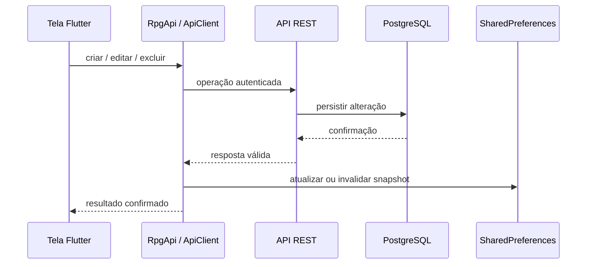

# RPG Manager Mobile

Flutter client for the existing RPG Manager REST API. The app does not connect
directly to PostgreSQL.

## Run

Start the backend from `backend/`, then run this project from `mobile/`:

```sh
flutter pub get
flutter run -d linux
```

The default API URL is `http://localhost:3000/api` on desktop and web. Android
emulators use `http://10.0.2.2:3000/api`. Override it for a device or deployed
backend with `--dart-define=API_BASE_URL=https://host.example/api`. For a
physical Android device, use the development machine's LAN address and ensure
the backend is reachable on the network. Cleartext HTTP is allowed only in
Android debug builds; use HTTPS for release builds.

The Linux secure-storage plugin requires the system package `libsecret-1-dev`.
Android builds require an installed Android SDK.

## Notas e missões

Notas e missões são sincronizadas pela API no workspace selecionado. Cada
registro pertence exclusivamente ao usuário autenticado; associá-lo a uma
campanha não o compartilha com outros participantes. É possível vincular uma
pasta ou campanha opcionalmente, editar e excluir registros, concluir/reabrir
missões e compartilhar uma exportação `.txt`.

## Personagens e monstros

Personagens podem ser associados a uma pasta opcional durante a criação ou
edição. A tela de pastas mostra personagens não arquivados na raiz e os demais
na pasta correspondente; a tela de personagens também permite filtrar por
pasta.

No workspace Mestre, a seção Monstros lista somente campanhas próprias.
Monstros ficam vinculados à campanha, exigem uma seleção explícita de sistema e
versão, e guardam seus dados específicos como JSON. Eles não são compartilhados
com participantes da campanha.

## Atividade 4 — persistência e funcionamento online/offline

### Modelo de dados

Os modelos Flutter validam e serializam JSON para usuários, campanhas,
participantes e personagens vinculados a campanhas, sistemas e versões,
personagens, monstros, pastas, notas e missões. Personagens e monstros mantêm
seus campos específicos do sistema em objetos JSON (`data`). Personagens podem
referenciar uma pasta; monstros pertencem a uma campanha e exigem sistema e
versão. Notas e missões podem referenciar uma pasta ou campanha.

| Entidade | Dados principais e relações |
|---|---|
| Usuário | ID, nome, nome de usuário e e-mail |
| Campanha | Proprietário, nome, descrição e estado ativo |
| Participante | Usuário e papel na campanha |
| Sistema / versão | Nome, slug, versão e relação com o sistema |
| Personagem | Nome, workspace, sistema/versão, dados JSON e pasta opcional |
| Monstro | Campanha, sistema/versão e dados JSON |
| Pasta | Nome e pasta-pai opcional |
| Nota | Título, conteúdo, data e pasta/campanha opcionais |
| Missão | Título, descrição, recompensa, estado e pasta/campanha opcionais |

O PostgreSQL do backend é a fonte de verdade para os registros remotos e suas
relações, chaves estrangeiras, restrições e autorização; `JSONB` permite
guardar dados específicos de cada sistema de RPG. O aplicativo Flutter não
acessa o banco diretamente: usa a API REST, que valida a sessão JWT e o
workspace.

### Persistência local

O aplicativo usa `shared_preferences` para snapshots JSON pequenos das
consultas de jogo que precisam estar disponíveis sem conexão. SharedPreferences
é adequado ao escopo limitado do cache e às preferências simples; não é um
banco relacional, não substitui o PostgreSQL e não é usado para credenciais.
O conjunto de registros por chave de cache tem limite de 512 KiB. O JWT fica
em `flutter_secure_storage`.

O cache de consultas fica separado por ID do usuário, workspace (`player` ou
`master`) e tipo de registro. Cada registro guarda payload JSON, datas,
versão local e estado (`CACHED` ou `LOCAL_ONLY`). Somente resultados
confirmados pela API são apresentados como cache remoto. Consultas de
autenticação, plano, assinatura e administração permanecem remotas.
`PersonaService` também guarda a preferência de workspace sob uma chave
específica do usuário; o JWT é mantido separadamente no armazenamento seguro.

### Arquitetura e fluxo

```mermaid
flowchart LR
  UI[Telas Flutter] --> API[RpgApi]
  API --> CLIENT[ApiClient]
  CLIENT -->|HTTP(S)/JSON + JWT e workspace| REST[API REST]
  REST --> DB[(PostgreSQL)]
  API -->|consulta bem-sucedida| CACHE[LocalStorageService]
  CACHE --> PREFS[(SharedPreferences: snapshots JSON)]
  API -->|falha de transporte em consulta| CACHE
```

Leituras tentam primeiro a API; uma resposta válida atualiza o cache e é
retornada à tela. Em falha de transporte, o serviço tenta o snapshot do mesmo
usuário e workspace e informa que os dados locais podem estar desatualizados.
Erros HTTP, inclusive `401` e `403`, e respostas inválidas não são convertidos
em falta de conexão.



Escritas são enviadas primeiro ao servidor. O cache só é atualizado ou
invalidado depois de uma resposta confirmada; uma falha de conexão não é
apresentada como sucesso. Não há fila de sincronização de escritas.

### Organização dos arquivos

- `lib/models/models.dart`: modelos e conversão JSON.
- `lib/core/api_client.dart`: cliente HTTP único, cabeçalhos, JWT e erros.
- `lib/services/rpg_api.dart`: operações REST, modelos, cache de consultas e
  origem/aviso dos dados.
- `lib/services/local_storage.dart`: snapshots e metadados em
  SharedPreferences, com isolamento por usuário/workspace e limite.
- `lib/widgets/local_cache_indicator.dart`: indicador reutilizável de dados
  locais.
- `lib/screens/`: estados de carregamento, erro, vazio e dados em cache nas
  telas de personagens, campanhas, pastas, notas/missões e monstros.
- `test/`: testes de modelos, armazenamento, cliente/API, cenários offline e
  widgets.

### Limitações conhecidas

- A sessão ainda é validada por `/auth/me` na inicialização; iniciar o app sem
  internet não restaura a sessão offline.
- Os snapshots são limitados a 512 KiB e não oferecem consultas relacionais,
  criptografia própria nem migração de dados do antigo SQLite.
- Não existe fila de alterações offline; uma escrita sem conexão não é salva
  no servidor e precisa ser repetida pelo usuário.
- Dados locais podem ficar desatualizados até uma consulta remota bem-sucedida.

## Validation

```sh
flutter analyze
flutter test
```

JWTs are stored with `flutter_secure_storage`. Authenticated requests attach
the stored token using the Bearer authorization scheme. A `401` clears the
stored token and returns to the login screen.
