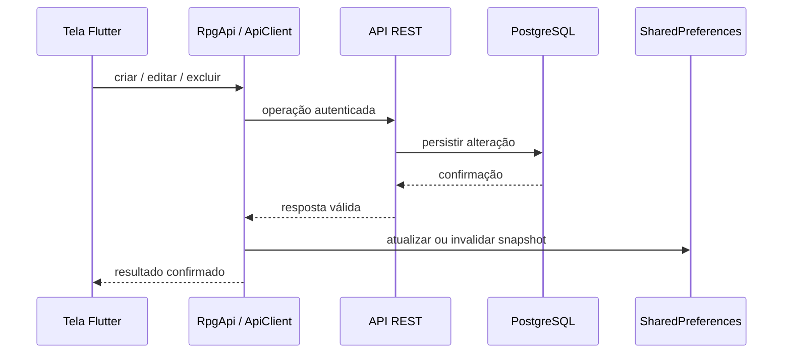

# RPG Manager Mobile

Flutter client for the existing RPG Manager REST API. The app does not connect
directly to PostgreSQL.

## Run

Start the backend from `backend/`, then run this project from `mobile/`:

```sh
flutter pub get
flutter run -d linux
```

The default API URL is `http://localhost:3000/api` on desktop and web. Android
emulators use `http://10.0.2.2:3000/api`. Override it for a device or deployed
backend with `--dart-define=API_BASE_URL=https://host.example`; the client
normalizes the URL to include exactly one `/api` suffix. For a physical Android
device, use the development machine's LAN address and ensure the backend is
reachable on the network. Cleartext HTTP is allowed only in Android debug
builds; use HTTPS for release builds.

The Linux secure-storage plugin requires the system package `libsecret-1-dev`.
Android builds require an installed Android SDK.

## Notas e missões

Notas e missões são sincronizadas pela API no workspace selecionado. Cada
registro pertence exclusivamente ao usuário autenticado; associá-lo a uma
campanha não o compartilha com outros participantes. É possível vincular uma
pasta ou campanha opcionalmente, editar e excluir registros, concluir/reabrir
missões e compartilhar uma exportação `.txt`.

## Personagens e monstros

Personagens podem ser associados a uma pasta opcional durante a criação ou
edição. A tela de pastas mostra personagens não arquivados na raiz e os demais
na pasta correspondente; a tela de personagens também permite filtrar por
pasta.

Na ficha do personagem, o botão de dados abre um rolador local, que funciona
sem conexão e não grava histórico. As opções de ficha seguem o comportamento
implementado no rolador Web: atributos D&D 5E, testes percentuais de Call of
Cthulhu 7ª edição e parada de atributo de Vampiro: A Máscara V5. Perícias,
salvaguardas, ataques e combinações de atributo/habilidade não são calculados
quando os dados da ficha não estão estruturados ou a regra não existe no
rolador Web.

No workspace Mestre, a seção Monstros lista somente campanhas próprias.
Monstros ficam vinculados à campanha, exigem uma seleção explícita de sistema e
versão, e guardam seus dados específicos como JSON. Eles não são compartilhados
com participantes da campanha.

## Iniciativa e combate

O proprietário de cada campanha no workspace Mestre pode criar combates,
adicionar personagens já vinculados à campanha ou participantes manuais do tipo
monstro/NPC, informar iniciativas e definir a ordem. A ordenação decrescente é
uma ação explícita; empates preservam a ordem manual. Turnos e rodadas são
persistidos no backend, e combates encerrados permanecem disponíveis como
histórico. A edição é validada pelo backend e não é enfileirada offline.

Antes do uso, aplique as migrations do backend (`npm run migrate` em
`backend/`). A lista consultada pode usar o cache local existente quando a rede
falha; alterações exigem conexão e só são exibidas como salvas após confirmação
da API. A iniciativa é manual e não aplica fórmulas específicas de sistemas.

## Convites e acesso a campanhas

No workspace Mestre, os detalhes de uma campanha incluem gerenciamento de
código/QR, convite direcionado por username e aprovação de solicitações
pendentes. Compartilhar um código ou QR não dá acesso imediato. No workspace
Jogador, a opção **Entrar em campanha** permite informar ou escanear o código,
solicitar participação, acompanhar o estado do pedido e aceitar ou recusar
convites direcionados.

Os convites por username só criam vínculo após o aceite do jogador; solicitações
por código só criam vínculo após a aprovação do Mestre. Os códigos não são
persistidos no cache local. O leitor QR usa a câmera do dispositivo e requer
permissão de câmera. Os dados e decisões são enviados à API e exigem conexão.
As tabelas correspondentes são criadas pela migration 019 do backend; aplique
as migrations com `npm run migrate` após configurar o PostgreSQL.

## Painel administrativo Mobile

As seções administrativas exibidas dependem das permissões retornadas pelo
backend: painel, usuários, planos, sistemas, assinaturas, pagamentos, despesas,
relatórios, auditoria e configurações. A busca e os filtros usam os parâmetros
aceitos pela API. Bloqueios, alterações de permissões, cancelamentos e estornos
exigem confirmação; o servidor impede bloquear ou retirar a última permissão do
último administrador ativo. As telas administrativas continuam remotas e não
usam cache offline.

Pagamentos e relatórios mostram registros internos. Não há checkout ou
confirmação por provedor externo; valores contratados de assinaturas não são
tratados como receita recebida, e os relatórios não convertem moedas.

## Atividade 4 — persistência e funcionamento online/offline

### Modelo de dados

Os modelos Flutter validam e serializam JSON para usuários, campanhas,
participantes e personagens vinculados a campanhas, sistemas e versões,
personagens, monstros, pastas, notas e missões. Personagens e monstros mantêm
seus campos específicos do sistema em objetos JSON (`data`). Personagens podem
referenciar uma pasta; monstros pertencem a uma campanha e exigem sistema e
versão. Notas e missões podem referenciar uma pasta ou campanha.

| Entidade | Dados principais e relações |
|---|---|
| Usuário | ID, nome, nome de usuário e e-mail |
| Campanha | Proprietário, nome, descrição e estado ativo |
| Participante | Usuário e papel na campanha |
| Sistema / versão | Nome, slug, versão e relação com o sistema |
| Personagem | Nome, workspace, sistema/versão, dados JSON e pasta opcional |
| Monstro | Campanha, sistema/versão e dados JSON |
| Pasta | Nome e pasta-pai opcional |
| Nota | Título, conteúdo, data e pasta/campanha opcionais |
| Missão | Título, descrição, recompensa, estado e pasta/campanha opcionais |

O PostgreSQL do backend é a fonte de verdade para os registros remotos e suas
relações, chaves estrangeiras, restrições e autorização; `JSONB` permite
guardar dados específicos de cada sistema de RPG. O aplicativo Flutter não
acessa o banco diretamente: usa a API REST, que valida a sessão JWT e o
workspace.

### Persistência local

O aplicativo usa `shared_preferences` para snapshots JSON pequenos das
consultas de jogo que precisam estar disponíveis sem conexão. Notas e missões
de contas autenticadas usam SQLite como armazenamento local; no modo visitante,
continuam em `shared_preferences` e não criam operações autenticadas na Outbox.
SharedPreferences não é um banco relacional, não substitui o PostgreSQL e não é
usado para credenciais. O conjunto de registros por chave de cache tem limite
de 512 KiB. O JWT fica em `flutter_secure_storage`.

O cache de consultas fica separado por ID do usuário, workspace (`player` ou
`master`) e tipo de registro. Cada registro guarda payload JSON, datas,
versão local e estado (`CACHED` ou `LOCAL_ONLY`). Somente resultados
confirmados pela API são apresentados como cache remoto. Consultas de
autenticação, plano, assinatura e administração permanecem remotas.
`PersonaService` também guarda a preferência de workspace sob uma chave
específica do usuário; o JWT é mantido separadamente no armazenamento seguro.

### Infraestrutura SQLite

Há uma camada SQLite versionada em `lib/core/database/`, com acesso por
`LocalRecordDao` e `OutboxDao`. A tabela genérica `local_records` separa
registros por proprietário, workspace, tipo e ID; a Outbox registra operações
pendentes no mesmo escopo. A versão 3 do esquema inclui a tabela da Outbox.
Notas e missões autenticadas tentam primeiro a API; quando há falha de
transporte, a consulta usa SQLite e as escritas alteram o registro e a Outbox
atomicamente. Edições pendentes são consolidadas; excluir um CREATE ainda não
enviado remove o registro e cancela a operação. Uma resposta remota confirmada
atualiza o SQLite sem enfileirar uma operação já realizada no servidor.

Esta etapa não processa nem envia operações da Outbox. Pastas e campanhas
continuam usando seus fluxos atuais. Em particular,
`NotesMissionsScreen._load()` aguarda notas, missões, pastas e campanhas em
conjunto; se pastas ou campanhas não puderem ser carregadas, a tela inteira
mostra erro mesmo que notas e missões estejam disponíveis em SQLite. Android
usa `sqflite`; Linux e Windows usam a implementação FFI. iOS e macOS usam o
plugin nativo. O alvo Web continua compilando, mas não oferece SQLite nesta
infraestrutura; nele, notas e missões preservam o cache online existente, mas
não podem enfileirar escritas offline nesta etapa.

### Persistência de login

Após login ou validação bem-sucedida, o app salva somente o perfil mínimo
(ID, nome, username e e-mail) em `LocalSessionService`, separado do JWT. Na
inicialização, o JWT continua sendo lido exclusivamente de
`flutter_secure_storage`; o perfil local permite abrir a interface e consultar
os snapshots do mesmo usuário/workspace se a API estiver indisponível. Esse
estado é identificado pelo ícone de nuvem riscada na barra superior e não é
considerado autenticação validada pelo servidor.

Uma resposta HTTP 401 remove o JWT e o perfil local e pede novo login. Falhas
de transporte e respostas HTTP 5xx preservam ambos e a validação é tentada
quando a conexão retorna, além de novas tentativas enquanto a API estiver
indisponível. A persona continua armazenada separadamente por ID do usuário.
Logout remove o JWT e o perfil de sessão, sem apagar os snapshots isolados da
conta.

No Android, as regras de backup excluem somente o arquivo de preferências
`FlutterSecureStorage` do backup em nuvem e da transferência entre dispositivos.
Isso evita restaurar o texto cifrado sem a chave do Android Keystore, preservando
o backup dos demais dados. Após restaurar o app em outro dispositivo, o usuário
precisará entrar novamente; reiniciar o mesmo dispositivo não é afetado.

### Arquitetura e fluxo

```mermaid
flowchart LR
  UI[Telas Flutter] --> API[RpgApi]
  API --> CLIENT[ApiClient]
  CLIENT -->|HTTP(S)/JSON + JWT e workspace| REST[API REST]
  REST --> DB[(PostgreSQL)]
  API -->|consulta bem-sucedida| CACHE[LocalStorageService]
  CACHE --> PREFS[(SharedPreferences: snapshots JSON)]
  API -->|falha de transporte em consulta| CACHE
```

Leituras tentam primeiro a API; uma resposta válida atualiza o cache e é
retornada à tela. Em falha de transporte, o serviço tenta o snapshot do mesmo
usuário e workspace e informa que os dados locais podem estar desatualizados.
Erros HTTP, inclusive `401` e `403`, e respostas inválidas não são convertidos
em falta de conexão.

`ConnectionService` observa mudanças de rede com `connectivity_plus` e confirma
acesso real à internet com uma requisição GET sem credenciais para
`https://www.google.com/generate_204`, usando o transporte já existente no
`ApiClient`, sem seguir redirecionamentos e com timeout de 3 segundos. A
verificação ocorre na inicialização, após mudanças de rede, após falhas da API
e a cada 30 segundos enquanto há rede e o app está ativo. A disponibilidade
externa e a disponibilidade da API são estados separados.

O aviso global é colocado acima do navegador pelo `MaterialApp.builder`: não
cobre os controles, desaparece quando online, mostra indisponibilidade da API
separadamente e exibe a reconexão por alguns segundos. O monitor é encerrado
com o app e pausa as sondagens em segundo plano.



Escritas são enviadas primeiro ao servidor. O cache só é atualizado ou
invalidado depois de uma resposta confirmada; uma falha de conexão não é
apresentada como sucesso. Não há fila de sincronização de escritas.

### Organização dos arquivos

- `lib/models/models.dart`: modelos e conversão JSON.
- `lib/core/api_client.dart`: cliente HTTP único, cabeçalhos, JWT e erros.
- `lib/services/rpg_api.dart`: operações REST, modelos, cache de consultas e
  origem/aviso dos dados.
- `lib/services/local_storage.dart`: snapshots e metadados em
  SharedPreferences, com isolamento por usuário/workspace e limite.
- `lib/services/local_session_service.dart`: perfil não secreto para retomar a
  identidade local, sem guardar o JWT.
- `android/app/src/main/res/xml/`: regras que excluem somente o arquivo de
  preferências do armazenamento seguro dos backups Android.
- `lib/widgets/local_cache_indicator.dart`: indicador reutilizável de dados
  locais.
- `lib/screens/`: estados de carregamento, erro, vazio e dados em cache nas
  telas de personagens, campanhas, pastas, notas/missões e monstros.
- `test/`: testes de modelos, armazenamento, cliente/API, cenários offline e
  widgets.

### Limitações conhecidas

- O perfil local é apenas uma identidade para acesso offline aos dados
  armazenados. Operações remotas continuam dependendo de validação online do
  JWT; autenticação não é simulada quando a API está indisponível.
- Os snapshots ainda usados por outras consultas são limitados a 512 KiB e não
  oferecem consultas relacionais nem criptografia própria.
- O SQLite mantém o UUID em `record_id` e pode associar a ele o ID numérico do
  servidor em `remote_id`. A persistência oferece uma conclusão transacional de
  CREATE que grava essa associação no registro e nas operações posteriores. O
  worker ainda não existe; a Outbox de notas e missões permanece local até uma
  etapa futura de sincronização.
- A tela de notas/missões também depende de pastas e campanhas, que não estão
  disponíveis offline sem snapshots locais utilizáveis.
- Dados locais podem ficar desatualizados até uma consulta remota bem-sucedida.
- A restauração após reinicialização física do aparelho e o comportamento de
  backup Android precisam de validação em dispositivo real; os testes
  automatizados cobrem recriação da aplicação e regras de sessão.

## Validation

```sh
flutter analyze
flutter test
```

JWTs are stored with `flutter_secure_storage`. Authenticated requests attach
the stored token using the Bearer authorization scheme. A `401` clears the
stored token and returns to the login screen.
