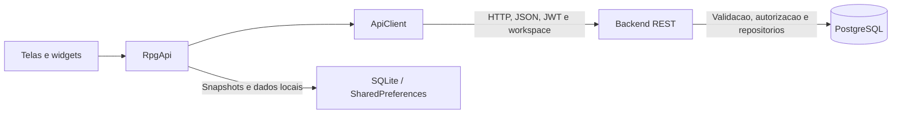

# RPG Manager Mobile

Cliente Flutter do RPG Manager. O aplicativo acessa os recursos remotos pela
API REST do projeto; **não se conecta diretamente ao PostgreSQL**. Também pode
armazenar alguns dados localmente para consulta e edição offline, conforme as
limitações descritas neste documento.

> Para arquitetura geral, Docker e configuração do backend, consulte o
> [README principal](../../README.md).

## Índice

- [Recursos do aplicativo](#recursos-do-aplicativo)
- [Requisitos e execução rápida](#requisitos-e-execução-rápida)
- [Configuração e comunicação com a API](#configuração-e-comunicação-com-a-api)
- [Execução Desktop no Linux e Windows](#execução-desktop-no-linux-e-windows)
- [Arquitetura e dados](#arquitetura-e-dados)
- [Persistência e modo offline](#persistência-e-modo-offline)
- [Outbox: implementação e estado da sincronização](#outbox-implementação-e-estado-da-sincronização)
- [Testes](#testes)
- [Limitações conhecidas](#limitações-conhecidas)

## Recursos do aplicativo

O Mobile oferece fluxos para os workspaces **Jogador** e **Mestre**, conforme
os recursos e permissões retornados pelo backend:

- Cadastro, login, validação de sessão, modo visitante e escolha de workspace.
- Campanhas, personagens, pastas, notas e missões.
- Monstros associados a campanhas no workspace Mestre.
- Convites, solicitações de participação e entrada em campanha por código/QR.
- Consulta de sistemas e versões de RPG.
- Combates de campanha, participantes e gerenciamento manual de iniciativa.
- Painel administrativo com seções condicionadas às permissões da conta.
- Cache de consultas, indicador de conectividade e persistência offline
  específica para notas e missões.

Os formulários e roladores abrangem **D&D 5E**, **Call of Cthulhu 7ª edição** e
**Vampiro: A Máscara V5**. O rolador da ficha é local e não grava histórico.
Regras que não estejam estruturadas para o personagem não são calculadas
automaticamente. A iniciativa é informada manualmente; o app não aplica
fórmulas específicas de cada sistema.

## Requisitos e execução rápida

- Flutter SDK compatível com a restrição Dart `^3.6.2` do `pubspec.yaml`. O Dart
  SDK correspondente acompanha o Flutter.
- Uma API RPG Manager disponível. Para desenvolvimento, inicie também o
  backend e configure o PostgreSQL/migrations conforme o
  [README principal](../../README.md).
- Para Android, Android SDK configurado (normalmente instalado pelo Android
  Studio). Android Studio não é requisito para executar o app em Linux ou
  Windows Desktop.

Na raiz do repositório, abra um terminal para o backend e configure o banco:

```bash
cd Projeto_DevSisWeb/backend
npm install
npm run migrate
npm run dev
```

Em outro terminal, inicie o Flutter. O padrão do cliente no Android Emulator é
`http://10.0.2.2:3000/api`; em Desktop e demais alvos é
`http://localhost:3000/api`.

```bash
cd Projeto_DevSisMob/mobile
flutter doctor
flutter pub get
flutter devices
flutter run
```

Para escolher explicitamente um dispositivo, use o identificador listado por
`flutter devices`, por exemplo `flutter run -d linux` ou
`flutter run -d windows`. A preparação dos alvos Desktop está descrita em
[Execução Desktop no Linux e Windows](#execução-desktop-no-linux-e-windows).

## Configuração e comunicação com a API

### URL base

O `ApiClient` lê `API_BASE_URL` em tempo de compilação usando
`String.fromEnvironment`. A URL é normalizada para terminar em um único `/api`:

| Alvo | Padrão do cliente |
|---|---|
| Android | `http://10.0.2.2:3000/api` |
| Linux, Windows, iOS, macOS e demais alvos | `http://localhost:3000/api` |

`localhost` aponta para a máquina onde o processo está executando. No Android
Emulator, use `10.0.2.2` para alcançar o computador hospedeiro. Em aparelho
físico, informe o IP da rede local do computador e permita a conexão na rede e
no firewall. Para produção, informe o domínio HTTPS real da API.

Exemplos:

```bash
# Android Emulator com backend local
flutter run --dart-define=API_BASE_URL=http://10.0.2.2:3000/api

# Linux Desktop com backend local
flutter run -d linux \
  --dart-define=API_BASE_URL=http://localhost:3000/api

# APK release com API pública; substitua pelo domínio real implantado
flutter build apk --release \
  --dart-define=API_BASE_URL=https://SEU-DOMINIO.vercel.app/api
```

No PowerShell, use:

```powershell
flutter run -d windows --dart-define="API_BASE_URL=http://localhost:3000/api"
flutter run -d windows --dart-define="API_BASE_URL=https://SEU-DOMINIO.vercel.app/api"
```

O domínio usado no build de release deve ser o domínio efetivo da API, não
necessariamente o domínio do frontend. O repositório não confirma um domínio
de produção ativo. No Android, tráfego HTTP sem TLS está habilitado no
manifesto de **debug**; para releases, use HTTPS.

### Requisições, sessão e autorização

O fluxo de chamadas é:



- `lib/core/api_client.dart` centraliza a URL da API, o transporte HTTP, a serialização JSON, o timeout, o gerenciamento do token e o tratamento de erros.
- `lib/services/rpg_api.dart` mapeia as operações REST para os modelos da aplicação e atualiza os caches após respostas confirmadas.
- As chamadas autenticadas enviam o token JWT no cabeçalho `Authorization: Bearer <JWT>`. Quando necessário, o workspace (`player` ou `master`) é enviado pelo cabeçalho `X-Workspace-Type`.
- O JWT é armazenado com `flutter_secure_storage`, não em `SharedPreferences`. As rotas de login e cadastro são públicas.
- O backend valida a identidade do JWT e aplica as regras de autorização e escopo de acesso. O aplicativo não acessa diretamente o banco de dados nem define o proprietário remoto no payload das requisições.
- Uma resposta HTTP `401` invalida a sessão local. Respostas `403`, `404`, demais falhas HTTP e falhas de transporte são tratadas separadamente. Erros de resposta HTTP não são interpretados automaticamente como falta de conexão com a internet.

### Recursos e regras de domínio

**Notas e missões** pertencem ao usuário autenticado e ao workspace ativo.
Pastas e campanhas são associações opcionais: vincular um registro a uma
campanha não o compartilha com os participantes. O app permite editar/excluir
registros, concluir/reabrir missões e compartilhar exportações `.txt`.

**Personagens** podem ser associados a uma pasta. As fichas e os dados
específicos do sistema são serializados em JSON. **Monstros** no workspace
Mestre são vinculados a campanhas próprias e exigem sistema e versão.

**Campanhas e convites:** códigos/QR permitem solicitar entrada, mas não
concedem acesso automaticamente. Solicitações feitas por código precisam ser
aprovadas pelo Mestre; convites direcionados por username precisam ser aceitos
pelo jogador. Os códigos não são persistidos no cache local. Leitura de QR usa
a câmera e exige a permissão correspondente.

**Combates:** o proprietário da campanha no workspace Mestre pode criar
combates, adicionar personagens da campanha ou participantes manuais do tipo
monstro/NPC e informar iniciativas. A ordenação decrescente é explícita;
empates preservam a ordem manual. Turnos e rodadas são salvos no backend.
Edições de combate exigem conexão e não entram na Outbox.

**Administração:** telas e ações dependem das permissões retornadas pelo
backend. Usuários, planos, sistemas, assinaturas, pagamentos, despesas,
relatórios, auditoria e configurações são recursos remotos, sem cache offline.
O backend protege as operações e impede remover a última permissão
administrativa necessária. O aplicativo exibe registros internos de pagamento;
não há provedor externo de pagamentos integrado. Um simulador de pagamento
controlado pelo backend pode estar disponível apenas em ambiente de
desenvolvimento quando habilitado.

As tabelas de campanhas/convites são criadas pelas migrations do backend;
antes de usá-las, aplique as migrations conforme o README principal.

## Execução Desktop no Linux e Windows

Os diretórios `linux/` e `windows/` contêm runners Flutter, configuração de
build e registradores de plugins. Portanto, é possível executar o app no
computador com `flutter run`, sem gerar APK.

### Linux

1. Instale o Flutter SDK e configure o `PATH`. O Dart SDK correspondente vem
   incluído no Flutter.
2. Em Debian/Ubuntu, instale as ferramentas de compilação Desktop, GTK e a
   dependência do plugin Linux de armazenamento seguro:

   ```bash
   sudo apt-get update
   sudo apt-get install clang cmake ninja-build pkg-config libgtk-3-dev libstdc++-12-dev libsecret-1-dev
   ```

3. Confira e habilite o alvo Linux Desktop:

   ```bash
   flutter doctor
   flutter config --enable-linux-desktop
   flutter devices
   ```

4. Execute a partir da pasta deste projeto:

   ```bash
   cd Projeto_DevSisMob/mobile
   flutter pub get
   flutter run -d linux
   ```

Para usar o backend local explicitamente:

```bash
flutter run -d linux \
  --dart-define=API_BASE_URL=http://localhost:3000/api
```

### Windows

1. Instale o Flutter SDK e configure o `PATH`.
2. Instale o **Visual Studio** (não somente Visual Studio Code), com a carga
   de trabalho **Desktop development with C++**, ferramentas C++, CMake e
   Windows SDK compatível.
3. No PowerShell, verifique o ambiente e habilite Windows Desktop:

   ```powershell
   flutter doctor
   flutter config --enable-windows-desktop
   flutter devices
   ```

4. Execute a partir da pasta deste projeto:

   ```powershell
   cd Projeto_DevSisMob\mobile
   flutter pub get
   flutter run -d windows
   ```

Com API local:

```powershell
flutter run -d windows --dart-define="API_BASE_URL=http://localhost:3000/api"
```

### Comparação e compatibilidade de plugins

| Sistema | Ferramentas necessárias | Execução | Observações |
|---|---|---|---|
| Linux | Flutter, clang, CMake, Ninja, GTK 3, ambiente gráfico e `libsecret-1-dev`. | `flutter run -d linux` | SQLite usa FFI. O plugin secure storage requer Secret Service/libsecret. `connectivity_plus` e `share_plus` não aparecem no registrador Linux gerado. |
| Windows | Flutter, Visual Studio com **Desktop development with C++**, CMake e Windows SDK. | `flutter run -d windows` | SQLite usa FFI; `connectivity_plus` e `share_plus` aparecem no registrador Windows gerado. |

Os plugins `mobile_scanner` e `image_picker` não aparecem nos registradores
gerados de Linux e Windows. Assim, leitura QR por câmera e seleção de imagens
não têm implementação Desktop confirmada. Em Linux, compartilhamento e
detecção nativa de conectividade também não estão registrados; a camada de
conectividade trata erros de plugin e faz sondagem externa, mas isso não
substitui o suporte nativo.

`flutter run` compila e executa uma versão de desenvolvimento com suporte a
depuração. Para gerar builds Desktop release, os alvos configurados aceitam:

```bash
flutter build linux --release
flutter build windows --release
```

Esses comandos criam artefatos de build; não significam que há instalador,
assinatura ou pacote de distribuição configurado no repositório.

## Arquitetura e dados

### Organização do código

| Caminho | Responsabilidade |
|---|---|
| `lib/core/api_client.dart` | Cliente HTTP, URL base, JWT, cabeçalhos, timeouts e erros. |
| `lib/core/database/` | Banco SQLite local, migrations, factories por plataforma e DAOs. |
| `lib/models/` | Modelos e serialização JSON. |
| `lib/screens/` | Telas e fluxos de interface. |
| `lib/services/rpg_api.dart` | Chamadas REST, transformação de respostas e coordenação de cache. |
| `lib/services/local_storage.dart` | Snapshots JSON e metadados em SharedPreferences. |
| `lib/services/local_session_service.dart` | Perfil local não secreto para retomar a interface. |
| `lib/services/persona_service.dart` | Preferência de workspace por usuário. |
| `lib/services/connection_service.dart` | Observação de conectividade e estado de disponibilidade da API. |
| `lib/services/outbox_sync_service.dart` | Processadores de operações da Outbox; ainda não iniciados automaticamente. |
| `lib/widgets/` | Componentes compartilhados, formulários e indicadores locais/conectividade. |
| `test/` | Testes de modelos, API, persistência, fluxos e widgets. |

### Entidades utilizadas

Os modelos Flutter serializam entidades retornadas pela API. Campos
específicos de sistema em personagens e monstros são preservados em objetos
JSON.

| Entidade | Relações/dados principais |
|---|---|
| Usuário | Identidade, username e e-mail. |
| Campanha | Proprietário, participantes e estado. |
| Participante | Usuário e papel na campanha. |
| Sistema/versão | Nome, slug e versões disponíveis. |
| Personagem | Workspace, sistema/versão, dados JSON e pasta opcional. |
| Monstro | Campanha, sistema/versão e dados JSON. |
| Pasta | Nome e pasta-pai opcional. |
| Nota | Título, conteúdo e pasta/campanha opcionais. |
| Missão | Título, descrição, recompensa, estado e pasta/campanha opcionais. |

## Persistência e modo offline

### Caches e sessão

`LocalStorageService` guarda snapshots pequenos das consultas para uso offline
limitado. Os dados são separados por usuário, workspace e tipo de registro; o
limite por chave do cache é 512 KiB. Registros marcados `LOCAL_ONLY` não são
apresentados como dados confirmados pelo servidor. SharedPreferences não é um
banco relacional, não substitui PostgreSQL e não guarda JWTs.

Após login ou validação bem-sucedida, `LocalSessionService` guarda somente um
perfil mínimo (ID, nome, username e e-mail), em separado do JWT. Se a API
estiver indisponível, esse perfil permite abrir a interface e consultar
snapshots daquele usuário/workspace, mas **não valida a autenticação no
servidor** nem habilita operações remotas. A tela indica estado de sessão local
com o ícone de nuvem riscada.

- Um `401` remove o token e o perfil local e exige novo login.
- Falhas de transporte e respostas `5xx` preservam a sessão local e permitem
  nova validação quando a conectividade volta.
- Logout remove JWT e perfil de sessão, mas mantém snapshots isolados da conta.
- O armazenamento seguro Android não é restaurado no backup/transferência do
  dispositivo; pode ser necessário autenticar novamente após restaurar em outro
  aparelho.

### SQLite

`LocalDatabase` usa uma sequência de migrations própria, independente das
migrations PostgreSQL do backend. A versão atual é **4**:

1. `local_records`, com escopo de usuário/workspace/tipo/ID.
2. Índice para consultas por escopo e data.
3. `outbox_operations` e índices de fila/lease.
4. Campo `remote_id` para associar UUID local ao ID numérico remoto.

Android usa `sqflite`; Linux e Windows usam `sqflite_common_ffi`; iOS e macOS
usam o plugin nativo. O alvo Web pode compilar, mas esta camada SQLite não está
disponível nele. Em modo visitante, notas e missões são guardadas localmente
em SharedPreferences e não criam operações autenticadas na Outbox.

Leituras autenticadas de notas e missões tentam primeiro a API e atualizam o
SQLite quando recebem resposta válida. Se houver falha de transporte, podem
usar registros SQLite do mesmo usuário/workspace. A tela de notas/missões
também carrega pastas e campanhas; se esses recursos necessários à tela não
estiverem disponíveis, a tela pode apresentar erro mesmo que existam notas e
missões locais.

Outras consultas de jogo podem usar snapshots de SharedPreferences. Recursos de
autenticação, plano, assinatura e administração permanecem remotos. Escritas
em recursos que não usam o fluxo local de notas/missões exigem conexão e só
são apresentadas como salvas após confirmação da API.

## Outbox: implementação e estado da sincronização

### Fluxo de uma alteração offline

Para notas e missões autenticadas, quando ocorre uma falha de transporte:

1. A operação é persistida em SQLite junto com o registro local, numa
   transação.
2. A Outbox registra proprietário, workspace, entidade, ID local, tipo
   `CREATE`, `UPDATE` ou `DELETE`, payload e estado.
3. UUIDs identificam registros locais. O `CREATE` inclui um `clientId`, que o
   backend usa no escopo de usuário/workspace para reconhecer reenvios.
4. Se o servidor confirmar a criação, a implementação do processador obtém o
   ID remoto e atualiza `remote_id` no registro e nas operações seguintes.
   `UPDATE` e `DELETE` usam esse ID remoto.

Edições pendentes podem ser consolidadas. Se um registro criado localmente e
ainda não enviado for excluído, a operação de criação e o registro local podem
ser removidos sem emitir um `DELETE` remoto.

### Limite atual: envio não automático

`OutboxSyncService` contém métodos para reivindicar e processar as operações
CREATE/UPDATE/DELETE de notas e missões. O DAO implementa leases, contagem de
tentativas, estados de falha e registro de erros; o serviço também persiste
falhas retentáveis e relança o erro da chamada.

**O serviço não é instanciado/chamado pelo aplicativo nem pelo
`ConnectionService`.** Portanto, esta versão não inicia um worker, não envia
automaticamente os registros pendentes e não retoma a fila ao reconectar. A
conectividade retornar não equivale a sincronização concluída. A Outbox cobre
somente notas e missões e não implementa sincronização P2P, Bluetooth ou
transferência entre aparelhos.

`ConnectionService` observa mudanças de rede com `connectivity_plus`, verifica
acesso externo por uma requisição sem credenciais a
`https://www.google.com/generate_204` (timeout de 3 segundos) e distingue
internet disponível de API indisponível. A verificação é feita na inicialização,
após mudanças/falhas e periodicamente enquanto o app está ativo. Ela atualiza
o indicador de estado e pode iniciar a validação de sessão; **não consome a
Outbox**.

## Testes

Na pasta `Projeto_DevSisMob/mobile/`:

```bash
flutter pub get
flutter analyze
flutter test
```

Os testes cobrem modelos, serialização, cliente HTTP, armazenamento,
comportamentos offline, Outbox e telas/widgets com dependências simuladas.
Eles não substituem uma validação ponta a ponta com backend e PostgreSQL
configurados.

## Limitações conhecidas

- O aplicativo não se conecta diretamente ao banco PostgreSQL; precisa da API
  para autenticação e operações remotas.
- Snapshots de consultas podem ficar desatualizados e têm limite de 512 KiB
  por chave; não oferecem consultas relacionais nem criptografia própria.
- O perfil local é apenas um estado de interface/cache, não autenticação
  offline validada pelo backend.
- A Outbox persiste algumas escritas offline, mas o envio automático ainda não
  está integrado.
- Pastas, campanhas, combate, convites, telas administrativas e outras
  entidades não passam por essa Outbox.
- A ficha de RPG não implementa todas as regras dos sistemas; iniciativa é
  manual e o rolador não grava histórico.
- Recursos que dependem de câmera/leitura QR e seleção de imagens não têm
  suporte Desktop confirmado; compartilhamento e detecção nativa de
  conectividade também variam por plataforma.
- O comportamento de backup/restauração Android e o uso dos plugins Desktop
  devem ser validados nos dispositivos/sistemas de destino.

