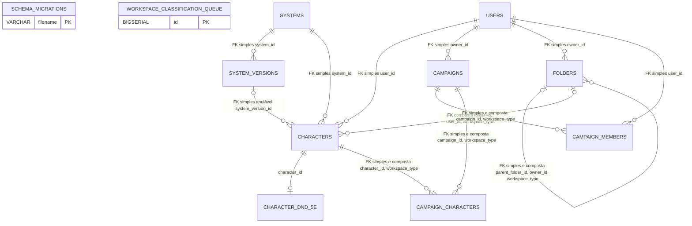
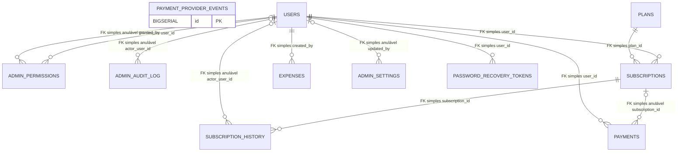

# Etapa 2 — DERs e dicionário de dados

## 1. Resumo da análise das migrations

Fonte da análise: as 19 migrations SQL de `backend/src/database/migrations/001` a `019`, consideradas em ordem, além da instrução de criação de `schema_migrations` em `backend/src/database/run.js`. O documento descreve a estrutura resultante dessas definições, não o estado de outro banco. Conforme informado para esta atividade, a aplicação das 19 migrations foi comprovada somente em `DevSisWeb_migration_validation`; não se presume que o banco `DevSisWeb` as tenha recebido.

Foram identificadas 30 tabelas: 29 definidas ou alteradas pelas migrations e `schema_migrations`, criada pelo executor. A estrutura inclui chaves primárias, chaves estrangeiras simples e compostas, restrições `UNIQUE` simples, compostas e parciais, verificações `CHECK`, valores padrão, ações referenciais e atributos anuláveis. As relações nos diagramas abaixo correspondem a FKs; regras de aplicação sem FK são explicitadas em seção separada.

Uma consequência importante da sequência de migrations é que `workspace_type` termina anulável em `characters`, `campaigns`, `folders`, `campaign_members` e `campaign_characters`: a migration 012 remove `NOT NULL` para preservar registros antigos não classificados. A mesma migration instala gatilhos que rejeitam novas inserções com valor nulo e alterações normais desse campo. Portanto, a nulabilidade da coluna no catálogo não significa que a aplicação possa inserir livremente `NULL`.

## 2. DER 1 — Núcleo, workspaces, personagens e campanhas

Na notação Mermaid abaixo, os símbolos indicam a cardinalidade na extremidade em que aparecem, contando registros dessa extremidade para cada registro da extremidade oposta: `||` significa exatamente um, `o|` zero ou um, e `o{` zero ou muitos. Assim, nas FKs anuláveis, `o|` no lado referenciado indica que cada dependente pode não ter registro associado; `o{` no lado dependente indica que cada registro referenciado pode ter vários dependentes. As arestas identificam se a ligação é uma FK simples ou composta. Uma FK composta é apresentada como uma única associação, não como várias relações independentes.

`SCHEMA_MIGRATIONS` e `WORKSPACE_CLASSIFICATION_QUEUE` são entidades autônomas neste DER, sem linhas de relacionamento. Na ligação personagem-versão, cada personagem pode ter zero ou uma versão; cada versão pode ser referenciada por zero ou muitos personagens. Não existe FK composta que compare `characters.system_id` com o `system_id` da versão. A tabela `CHARACTER_DND_5E` é opcional para cada personagem, e cada ficha pertence obrigatoriamente a um único personagem.

## 3. DER 2 — Registros, monstros, combates e convites

As entidades `USERS`, `CAMPAIGNS`, `FOLDERS`, `CHARACTERS`, `SYSTEMS` e `SYSTEM_VERSIONS` aparecem aqui como contexto, por serem alvos de FKs; sua cobertura principal está no DER 1.

```mermaid
erDiagram
    USERS ||--o{ NOTES : "FK simples owner_id"
    FOLDERS o|--o{ NOTES : "FK composta folder_id, owner_id, workspace_type"
    CAMPAIGNS o|--o{ NOTES : "FK composta campaign_id, workspace_type"
    USERS ||--o{ MISSIONS : "FK simples owner_id"
    FOLDERS o|--o{ MISSIONS : "FK composta folder_id, owner_id, workspace_type"
    CAMPAIGNS o|--o{ MISSIONS : "FK composta campaign_id, workspace_type"
    CAMPAIGNS ||--o{ MONSTERS : "FK composta campaign_id, owner_id, workspace_type"
    SYSTEM_VERSIONS ||--o{ MONSTERS : "FK composta system_id, system_version_id"
    CAMPAIGNS ||--o{ CAMPAIGN_COMBATS : "FK composta campaign_id, owner_id, workspace_type"
    CAMPAIGN_COMBATS ||--o{ CAMPAIGN_COMBAT_PARTICIPANTS : "FK composta combat_id e contexto"
    CHARACTERS o|--o{ CAMPAIGN_COMBAT_PARTICIPANTS : "FK simples anulável character_id"
    CAMPAIGN_COMBATS o|--o| CAMPAIGN_COMBAT_PARTICIPANTS : "FK composta anulável id, current_participant_id"
    CAMPAIGNS ||--o{ CAMPAIGN_INVITE_CODES : "FK composta campaign_id, owner_id, workspace_type"
    CAMPAIGNS ||--o{ CAMPAIGN_JOIN_REQUESTS : "FK composta campaign_id, workspace_type"
    USERS ||--o{ CAMPAIGN_JOIN_REQUESTS : "FK simples requester_id"
    CAMPAIGN_INVITE_CODES o|--o{ CAMPAIGN_JOIN_REQUESTS : "FK simples anulável invite_code_id"
    USERS o|--o{ CAMPAIGN_JOIN_REQUESTS : "FK simples anulável reviewed_by"
    CAMPAIGNS ||--o{ CAMPAIGN_USER_INVITATIONS : "FK composta campaign_id, invited_by, workspace_type"
    USERS ||--o{ CAMPAIGN_USER_INVITATIONS : "FK simples target_user_id"
    USERS ||--o| CAMPAIGN_INVITE_ATTEMPTS : "FK/PK user_id"
```

Há um ciclo estrutural entre `CAMPAIGN_COMBATS` e `CAMPAIGN_COMBAT_PARTICIPANTS`: cada participante pertence obrigatoriamente a um combate pela FK composta; cada combate pode selecionar zero ou um participante atual pela FK composta anulável `(id, current_participant_id)`. Um participante pode ser o selecionado atual de zero ou um combate. A FK de personagem do participante também é opcional; não há FK para `MONSTERS`.

Em `CAMPAIGN_USER_INVITATIONS`, `invited_by` não é uma FK simples para `USERS`: a FK composta da campanha exige que o valor corresponda ao `owner_id` daquela campanha. As cardinalidades mostram a relação estrutural e não a limitação de índices únicos parciais a determinados estados, como um único convite pendente ou um único combate aberto.

## 4. DER 3 — Administração, planos, financeiro e segurança

`USERS` aparece como entidade de contexto, já representada no DER 1.

`PAYMENT_PROVIDER_EVENTS` é apresentada sem arestas porque não possui FK para pagamentos, assinaturas ou usuários. Não há associação estrutural entre eventos do provedor e um pagamento específico. Em `ADMIN_SETTINGS`, cada configuração pode ter zero ou um usuário associado em `updated_by`; um usuário pode atualizar várias configurações. A FK/PK de `CAMPAIGN_INVITE_ATTEMPTS` representa no máximo um registro por usuário.

## 5. Relação de cobertura das 30 tabelas

| DER | Tabelas cobertas como parte principal |
|---|---|
| DER 1 — Núcleo | `schema_migrations`, `workspace_classification_queue`, `users`, `systems`, `system_versions`, `characters`, `character_dnd_5e`, `folders`, `campaigns`, `campaign_members`, `campaign_characters` (11) |
| DER 2 — Registros e campanhas | `notes`, `missions`, `monsters`, `campaign_combats`, `campaign_combat_participants`, `campaign_invite_codes`, `campaign_join_requests`, `campaign_user_invitations`, `campaign_invite_attempts` (9) |
| DER 3 — Administração e financeiro | `plans`, `admin_permissions`, `admin_audit_log`, `subscriptions`, `subscription_history`, `payments`, `payment_provider_events`, `expenses`, `admin_settings`, `password_recovery_tokens` (10) |
| **Total de tabelas distintas** | **30** |

O DER 2 repete como contexto `users`, `campaigns`, `folders`, `characters` e `system_versions`; o DER 3 repete `users`. Essas aparições não representam tabelas adicionais.

## 6. Dicionário de dados completo

**Convenções:** “Não” em Nulo? significa `NOT NULL` ou chave primária; “Sim” significa que a coluna aceita `NULL` na estrutura final. `PK`, `FK`, `FK composta`, `UQ` e `PK/FK` identificam chaves e unicidade. O detalhamento após cada tabela descreve FKs, unicidades e verificações relevantes. A ausência de cláusula `ON DELETE` em uma FK significa o comportamento padrão do PostgreSQL (`NO ACTION`).

### Módulo 1 — Controle de migrations e classificação de workspaces

#### Tabela: `schema_migrations`

Criada pelo executor `backend/src/database/run.js` para registrar quais arquivos de migration foram aplicados.

| Atributo | Tipo | Chave/constraint | Nulo? | Padrão | Significado |
|---|---|---|---|---|---|
| `filename` | `VARCHAR(255)` | PK | Não | — | Nome do arquivo de migration registrado como aplicado. |
| `applied_at` | `TIMESTAMPTZ` | — | Não | `NOW()` | Data e hora em que o executor registrou a aplicação do arquivo. |

Não possui FK. Esta tabela não é criada por um dos 19 arquivos de migration; sua DDL está no executor.

#### Tabela: `workspace_classification_queue`

Fila e trilha de auditoria para registros legados cujo workspace não pôde ser classificado com segurança.

| Atributo | Tipo | Chave/constraint | Nulo? | Padrão | Significado |
|---|---|---|---|---|---|
| `id` | `BIGSERIAL` | PK | Não | sequência | Identificador da ocorrência de classificação. |
| `table_name` | `VARCHAR(40)` | CHECK | Não | — | Nome da tabela de origem; limitado a `characters`, `campaigns`, `folders`, `campaign_members` ou `campaign_characters`. |
| `record_key` | `JSONB` | — | Não | — | Identificadores e contexto do registro de origem preservados para análise manual. |
| `previous_workspace_type` | `VARCHAR(20)` | — | Sim | — | Valor de workspace observado antes da classificação. |
| `reason` | `TEXT` | — | Não | — | Motivo pelo qual a classificação exige análise. |
| `status` | `VARCHAR(20)` | CHECK | Não | `'pending'` | Estado da fila: `pending` ou `classified`. |
| `classified_workspace_type` | `VARCHAR(20)` | CHECK | Sim | — | Workspace atribuído após classificação explícita: `player` ou `master`. |
| `created_at` | `TIMESTAMPTZ` | — | Não | `NOW()` | Data e hora em que a ocorrência foi registrada. |
| `classified_at` | `TIMESTAMPTZ` | — | Sim | — | Data e hora em que a classificação foi concluída. |

Não possui PK/FK apontando para as tabelas de origem: `table_name` e `record_key` são referências documentais, não relacionamentos referenciais. `table_name` tem lista de valores permitidos. A consistência exige `pending` com classificação e data nulas, ou `classified` com ambas preenchidas. Há índice não único em `(status, table_name)`.

### Módulo 2 — Usuários e autenticação

#### Tabela: `users`

Contas de usuário referenciadas por personagens, campanhas, permissões e operações administrativas.

| Atributo | Tipo | Chave/constraint | Nulo? | Padrão | Significado |
|---|---|---|---|---|---|
| `id` | `BIGSERIAL` | PK | Não | sequência | Identificador único da conta. |
| `name` | `VARCHAR(120)` | — | Não | — | Nome da pessoa usuária. |
| `username` | `VARCHAR(50)` | UQ | Não | — | Nome de usuário único para identificação. |
| `email` | `VARCHAR(254)` | UQ | Não | — | Endereço de e-mail único da conta. |
| `password_hash` | `VARCHAR(255)` | — | Não | — | Hash da senha armazenado para autenticação. |
| `is_active` | `BOOLEAN` | — | Não | `TRUE` | Indica se a conta está ativa. |
| `created_at` | `TIMESTAMPTZ` | — | Não | `NOW()` | Data e hora de criação da conta. |
| `updated_at` | `TIMESTAMPTZ` | — | Não | `NOW()` | Data e hora da última atualização registrada. |
| `last_login_at` | `TIMESTAMPTZ` | — | Sim | — | Data e hora do último acesso registrado. |

`username` e `email` têm unicidade individual. Os índices adicionais de busca em ambos os campos não alteram a nulabilidade nem criam novas chaves.

### Módulo 3 — Sistemas e versões

#### Tabela: `systems`

Catálogo de sistemas de RPG.

| Atributo | Tipo | Chave/constraint | Nulo? | Padrão | Significado |
|---|---|---|---|---|---|
| `id` | `BIGSERIAL` | PK | Não | sequência | Identificador do sistema. |
| `name` | `VARCHAR(120)` | UQ | Não | — | Nome de exibição do sistema. |
| `slug` | `VARCHAR(120)` | UQ | Não | — | Identificador textual estável do sistema. |
| `description` | `TEXT` | — | Sim | — | Descrição do sistema. |
| `is_active` | `BOOLEAN` | — | Não | `TRUE` | Indica se o sistema está ativo no catálogo. |
| `created_at` | `TIMESTAMPTZ` | — | Não | `NOW()` | Data e hora de criação do registro. |
| `updated_at` | `TIMESTAMPTZ` | — | Não | `NOW()` | Data e hora da última atualização registrada. |

`name` e `slug` são únicos separadamente.

#### Tabela: `system_versions`

Versões editoriais ou regras de um sistema de RPG.

| Atributo | Tipo | Chave/constraint | Nulo? | Padrão | Significado |
|---|---|---|---|---|---|
| `id` | `BIGSERIAL` | PK | Não | sequência | Identificador da versão. |
| `system_id` | `BIGINT` | FK | Não | — | Sistema ao qual a versão pertence. |
| `name` | `VARCHAR(120)` | — | Não | — | Nome de exibição da versão. |
| `slug` | `VARCHAR(120)` | — | Não | — | Identificador textual da versão dentro do sistema. |
| `description` | `TEXT` | — | Sim | — | Descrição da versão. |
| `created_at` | `TIMESTAMPTZ` | — | Não | `NOW()` | Data e hora de criação do registro. |
| `updated_at` | `TIMESTAMPTZ` | — | Não | `NOW()` | Data e hora da última atualização registrada. |

FK `system_id` → `systems.id`, `ON DELETE RESTRICT`. `UNIQUE (system_id, slug)` impede slugs repetidos dentro do mesmo sistema. `UNIQUE (system_id, id)` fornece a chave candidata utilizada pela FK composta dos monstros. `system_id` recebe índice não único.

### Módulo 4 — Personagens e fichas

#### Tabela: `characters`

Personagens de usuário, com dados gerais em JSONB e ligações opcionais a uma versão e pasta.

| Atributo | Tipo | Chave/constraint | Nulo? | Padrão | Significado |
|---|---|---|---|---|---|
| `id` | `BIGSERIAL` | PK | Não | sequência | Identificador do personagem. |
| `user_id` | `BIGINT` | FK | Não | — | Usuário proprietário do personagem. |
| `system_id` | `BIGINT` | FK | Não | — | Sistema selecionado para o personagem. |
| `name` | `VARCHAR(120)` | — | Não | — | Nome do personagem. |
| `created_at` | `TIMESTAMPTZ` | — | Não | `NOW()` | Data e hora de criação. |
| `updated_at` | `TIMESTAMPTZ` | — | Não | `NOW()` | Data e hora da última atualização registrada. |
| `dados` | `JSONB` | — | Não | `'{}'::jsonb` | Dados gerais da ficha mantidos como objeto JSON. |
| `system_version_id` | `BIGINT` | FK | Sim | — | Versão de regras escolhida para o personagem. |
| `workspace_type` | `VARCHAR(20)` | CHECK; parte de UQs/FKs compostas | Sim (legado) | nenhum após migration 012 | Workspace do personagem: `player` ou `master`; registros legados podem permanecer sem classificação. |
| `folder_id` | `BIGINT` | FK composta | Sim | — | Pasta do personagem, quando organizado em uma pasta compatível. |

FKs: `user_id` → `users.id` (`CASCADE`); `system_id` → `systems.id` (`RESTRICT`); `system_version_id` → `system_versions.id` (`RESTRICT`); `(folder_id, user_id, workspace_type)` → `(folders.id, owner_id, workspace_type)`. A FK da pasta não declara ação `ON DELETE`; a migration 014 também instala gatilho que desassocia personagens antes da exclusão da pasta. Há `UNIQUE (id, workspace_type)` para a FK composta de `campaign_characters`.

`workspace_type` aceita nulo pela restrição `CHECK` final (`NULL`, `player` ou `master`), mas gatilho rejeita novas linhas nulas e mudanças comuns do valor. Não existe FK composta que imponha que `system_id` seja o sistema proprietário da linha indicada por `system_version_id`; essas duas FKs são independentes.

#### Tabela: `character_dnd_5e`

Campos estruturados específicos da ficha D&D 5e. A presença dessa tabela e de `spells_and_slots` descreve persistência de dados; não afirma que Magias e Habilidades sejam funcionalidade atual do Web.

| Atributo | Tipo | Chave/constraint | Nulo? | Padrão | Significado |
|---|---|---|---|---|---|
| `character_id` | `BIGINT` | PK/FK | Não | — | Personagem ao qual a ficha pertence. |
| `player_name` | `TEXT` | — | Sim | — | Nome do jogador associado à ficha. |
| `class` | `TEXT` | — | Sim | — | Classe do personagem. |
| `level` | `INTEGER` | CHECK | Sim | — | Nível do personagem; quando informado, deve ser pelo menos 1. |
| `race` | `TEXT` | — | Sim | — | Raça do personagem. |
| `background` | `TEXT` | — | Sim | — | Antecedente do personagem. |
| `alignment` | `TEXT` | — | Sim | — | Tendência/alinhamento registrado na ficha. |
| `experience_points` | `INTEGER` | — | Sim | — | Pontos de experiência. |
| `description` | `TEXT` | — | Sim | — | Descrição textual do personagem. |
| `strength` | `INTEGER` | — | Sim | — | Valor do atributo Força. |
| `dexterity` | `INTEGER` | — | Sim | — | Valor do atributo Destreza. |
| `constitution` | `INTEGER` | — | Sim | — | Valor do atributo Constituição. |
| `intelligence` | `INTEGER` | — | Sim | — | Valor do atributo Inteligência. |
| `wisdom` | `INTEGER` | — | Sim | — | Valor do atributo Sabedoria. |
| `charisma` | `INTEGER` | — | Sim | — | Valor do atributo Carisma. |
| `armor_class` | `INTEGER` | — | Sim | — | Classe de armadura. |
| `initiative` | `TEXT` | — | Sim | — | Iniciativa registrada na ficha. |
| `speed` | `TEXT` | — | Sim | — | Deslocamento registrado na ficha. |
| `max_hit_points` | `INTEGER` | — | Sim | — | Pontos de vida máximos. |
| `current_hit_points` | `INTEGER` | — | Sim | — | Pontos de vida atuais. |
| `temporary_hit_points` | `INTEGER` | — | Sim | — | Pontos de vida temporários. |
| `hit_dice` | `TEXT` | — | Sim | — | Dados de vida registrados. |
| `proficiency_bonus` | `TEXT` | — | Sim | — | Bônus de proficiência registrado. |
| `skills_and_saving_throws` | `TEXT` | — | Sim | — | Perícias e testes de resistência registrados. |
| `attacks_and_spellcasting` | `TEXT` | — | Sim | — | Ataques e informações de conjuração registradas na ficha. |
| `equipment_and_treasure` | `TEXT` | — | Sim | — | Equipamentos e tesouros registrados. |
| `spells_and_slots` | `TEXT` | — | Sim | — | Campo textual de dados de magias e espaços de magia da ficha. |
| `personality_ideals_bonds_flaws` | `TEXT` | — | Sim | — | Traços de personalidade, ideais, vínculos e defeitos. |
| `history_allies_organizations` | `TEXT` | — | Sim | — | História, aliados e organizações registrados. |
| `created_at` | `TIMESTAMPTZ` | — | Não | `NOW()` | Data e hora de criação do registro da ficha. |
| `updated_at` | `TIMESTAMPTZ` | — | Não | `NOW()` | Data e hora da última atualização registrada. |

FK `character_id` → `characters.id`, `ON DELETE CASCADE`. A chave primária impede mais de uma ficha D&D 5e estruturada por personagem. Não há `CHECK` além de `level IS NULL OR level >= 1`.

### Módulo 5 — Pastas

#### Tabela: `folders`

Pastas de propriedade de usuário, organizadas por workspace e com hierarquia autorreferente.

| Atributo | Tipo | Chave/constraint | Nulo? | Padrão | Significado |
|---|---|---|---|---|---|
| `id` | `BIGSERIAL` | PK | Não | sequência | Identificador da pasta. |
| `owner_id` | `BIGINT` | FK | Não | — | Usuário proprietário da pasta. |
| `parent_folder_id` | `BIGINT` | FK simples e composta | Sim | — | Pasta-pai, quando a pasta está aninhada. |
| `name` | `VARCHAR(120)` | — | Não | — | Nome da pasta. |
| `created_at` | `TIMESTAMPTZ` | — | Não | `NOW()` | Data e hora de criação. |
| `updated_at` | `TIMESTAMPTZ` | — | Não | `NOW()` | Data e hora da última atualização registrada. |
| `workspace_type` | `VARCHAR(20)` | CHECK; parte de UQ/FK composta | Sim (legado) | nenhum após migration 012 | Workspace da pasta: `player` ou `master`; pode ser nulo em registro legado não classificado. |

FKs: `owner_id` → `users.id` (`CASCADE`); `parent_folder_id` → `folders.id` (`CASCADE`); `(parent_folder_id, owner_id, workspace_type)` → `(folders.id, owner_id, workspace_type)` (`CASCADE`). A FK composta impede que a pasta-pai pertença a outro proprietário ou workspace, quando os campos que participam da chave composta não são nulos. `UNIQUE (id, owner_id, workspace_type)` dá suporte às FKs compostas de personagens, notas e missões.

O `CHECK` final aceita workspace nulo ou os valores `player` e `master`. O gatilho de workspace rejeita inserções novas nulas e alterações comuns do workspace. A hierarquia não tem restrição contra ciclos de múltiplos níveis.

### Módulo 6 — Campanhas e participantes

#### Tabela: `campaigns`

Campanhas criadas por um usuário e associadas a um workspace.

| Atributo | Tipo | Chave/constraint | Nulo? | Padrão | Significado |
|---|---|---|---|---|---|
| `id` | `BIGSERIAL` | PK | Não | sequência | Identificador da campanha. |
| `owner_id` | `BIGINT` | FK | Não | — | Usuário proprietário da campanha. |
| `name` | `VARCHAR(120)` | — | Não | — | Nome da campanha. |
| `description` | `TEXT` | — | Sim | — | Descrição da campanha. |
| `is_active` | `BOOLEAN` | — | Não | `TRUE` | Indica se a campanha está ativa. |
| `created_at` | `TIMESTAMPTZ` | — | Não | `NOW()` | Data e hora de criação. |
| `updated_at` | `TIMESTAMPTZ` | — | Não | `NOW()` | Data e hora da última atualização registrada. |
| `workspace_type` | `VARCHAR(20)` | CHECK; parte de UQs/FKs compostas | Sim (legado) | nenhum após migration 012 | Workspace da campanha: `player` ou `master`; pode ser nulo em registro legado não classificado. |

FK `owner_id` → `users.id`, `ON DELETE CASCADE`. O workspace tem `CHECK` que aceita nulo ou `player`/`master`, com gatilho que impede nulo em novas inserções e mudanças não autorizadas. Chaves candidatas: `UNIQUE (id, workspace_type)` e `UNIQUE (id, owner_id, workspace_type)`, usadas por FKs compostas de outros módulos. A migration 013 instala gatilho que desvincula notas e missões antes de excluir a campanha.

#### Tabela: `campaign_members`

Vínculo de usuário participante com campanha, incluindo papel e workspace.

| Atributo | Tipo | Chave/constraint | Nulo? | Padrão | Significado |
|---|---|---|---|---|---|
| `id` | `BIGSERIAL` | PK | Não | sequência | Identificador do vínculo de participação. |
| `campaign_id` | `BIGINT` | FK simples e composta | Não | — | Campanha da participação. |
| `user_id` | `BIGINT` | FK | Não | — | Usuário participante. |
| `role` | `VARCHAR(30)` | — | Não | `'player'` | Papel atribuído ao usuário na campanha. |
| `joined_at` | `TIMESTAMPTZ` | — | Não | `NOW()` | Data e hora de ingresso. |
| `workspace_type` | `VARCHAR(20)` | CHECK; parte de FK composta | Sim (legado) | nenhum após migration 012 | Workspace do vínculo: `player` ou `master`; pode ser nulo em registro legado. |

FKs: `campaign_id` → `campaigns.id` (`CASCADE`); `user_id` → `users.id` (`CASCADE`); `(campaign_id, workspace_type)` → `(campaigns.id, workspace_type)` (`CASCADE`). `UNIQUE (campaign_id, user_id)` impede repetição do mesmo usuário na campanha. O `CHECK` de workspace permite nulo em registros legados; gatilho impede inserções novas com nulo e alterações comuns.

#### Tabela: `campaign_characters`

Vínculo de personagem com campanha.

| Atributo | Tipo | Chave/constraint | Nulo? | Padrão | Significado |
|---|---|---|---|---|---|
| `id` | `BIGSERIAL` | PK | Não | sequência | Identificador do vínculo personagem-campanha. |
| `campaign_id` | `BIGINT` | FK simples e composta | Não | — | Campanha à qual o personagem foi associado. |
| `character_id` | `BIGINT` | FK simples e composta | Não | — | Personagem associado à campanha. |
| `joined_at` | `TIMESTAMPTZ` | — | Não | `NOW()` | Data e hora em que o personagem foi associado. |
| `workspace_type` | `VARCHAR(20)` | CHECK; parte de FKs compostas | Sim (legado) | nenhum após migration 012 | Workspace da associação: `player` ou `master`; pode ser nulo em registro legado. |

FKs: `campaign_id` → `campaigns.id` (`CASCADE`); `character_id` → `characters.id` (`CASCADE`); `(campaign_id, workspace_type)` → `(campaigns.id, workspace_type)` (`CASCADE`); `(character_id, workspace_type)` → `(characters.id, workspace_type)` (`CASCADE`). `UNIQUE (campaign_id, character_id)` impede repetir o personagem na campanha. O `CHECK` e o gatilho de workspace têm o mesmo comportamento legado descrito para `campaign_members`.

### Módulo 7 — Notas e missões

#### Tabela: `notes`

Nota privada pertencente a um usuário e workspace, com ligações opcionais a pasta e campanha.

| Atributo | Tipo | Chave/constraint | Nulo? | Padrão | Significado |
|---|---|---|---|---|---|
| `id` | `BIGSERIAL` | PK | Não | sequência | Identificador da nota. |
| `client_id` | `UUID` | UQ composta | Não | `gen_random_uuid()` | Identificador gerado no cliente para distinguir a nota dentro do proprietário e workspace. |
| `owner_id` | `BIGINT` | FK | Não | — | Usuário proprietário da nota. |
| `workspace_type` | `VARCHAR(20)` | CHECK; parte de FKs/UQs compostas | Não | — | Workspace da nota: `player` ou `master`. |
| `folder_id` | `BIGINT` | FK composta | Sim | — | Pasta da nota, se organizada em pasta do mesmo proprietário e workspace. |
| `campaign_id` | `BIGINT` | FK composta | Sim | — | Campanha associada à nota, quando houver. |
| `title` | `VARCHAR(160)` | — | Não | — | Título da nota. |
| `content` | `TEXT` | — | Não | — | Conteúdo textual da nota. |
| `created_at` | `TIMESTAMPTZ` | — | Não | `NOW()` | Data e hora de criação. |
| `updated_at` | `TIMESTAMPTZ` | — | Não | `NOW()` | Data e hora da última atualização registrada. |

FKs: `owner_id` → `users.id` (`CASCADE`); `(folder_id, owner_id, workspace_type)` → `(folders.id, owner_id, workspace_type)`; `(campaign_id, workspace_type)` → `(campaigns.id, workspace_type)`. As duas FKs compostas não definem `ON DELETE`; a migration 013 instala gatilhos que limpam `folder_id` ou `campaign_id` antes da exclusão de pasta ou campanha. `UNIQUE (owner_id, workspace_type, client_id)`; também `UNIQUE (id, owner_id, workspace_type)`. `workspace_type` só aceita `player` ou `master`.

#### Tabela: `missions`

Missão privada pertencente a um usuário e workspace, com ligações opcionais a pasta e campanha.

| Atributo | Tipo | Chave/constraint | Nulo? | Padrão | Significado |
|---|---|---|---|---|---|
| `id` | `BIGSERIAL` | PK | Não | sequência | Identificador da missão. |
| `client_id` | `UUID` | UQ composta | Não | `gen_random_uuid()` | Identificador gerado no cliente para distinguir a missão dentro do proprietário e workspace. |
| `owner_id` | `BIGINT` | FK | Não | — | Usuário proprietário da missão. |
| `workspace_type` | `VARCHAR(20)` | CHECK; parte de FKs/UQs compostas | Não | — | Workspace da missão: `player` ou `master`. |
| `folder_id` | `BIGINT` | FK composta | Sim | — | Pasta da missão, se organizada em pasta do mesmo proprietário e workspace. |
| `campaign_id` | `BIGINT` | FK composta | Sim | — | Campanha associada à missão, quando houver. |
| `title` | `VARCHAR(160)` | — | Não | — | Título da missão. |
| `description` | `TEXT` | — | Não | — | Descrição e objetivo da missão. |
| `reward` | `VARCHAR(2000)` | — | Não | `''` | Recompensa registrada para a missão. |
| `status` | `VARCHAR(20)` | CHECK | Não | `'em_progresso'` | Situação da missão: `em_progresso` ou `concluida`. |
| `created_at` | `TIMESTAMPTZ` | — | Não | `NOW()` | Data e hora de criação. |
| `updated_at` | `TIMESTAMPTZ` | — | Não | `NOW()` | Data e hora da última atualização registrada. |

FKs: `owner_id` → `users.id` (`CASCADE`); `(folder_id, owner_id, workspace_type)` → `(folders.id, owner_id, workspace_type)`; `(campaign_id, workspace_type)` → `(campaigns.id, workspace_type)`. As FKs compostas não declaram ação `ON DELETE`; gatilhos da migration 013 desassociam missões antes da exclusão de pasta ou campanha. `UNIQUE (owner_id, workspace_type, client_id)`; também `UNIQUE (id, owner_id, workspace_type)`. `workspace_type` aceita `player`/`master`.

### Módulo 8 — Monstros e combates

#### Tabela: `monsters`

Monstro criado para uma campanha, associado a um proprietário, workspace mestre e versão de sistema.

| Atributo | Tipo | Chave/constraint | Nulo? | Padrão | Significado |
|---|---|---|---|---|---|
| `id` | `BIGSERIAL` | PK | Não | sequência | Identificador do monstro. |
| `campaign_id` | `BIGINT` | FK composta | Não | — | Campanha em que o monstro está registrado. |
| `owner_id` | `BIGINT` | FK composta | Não | — | Proprietário da campanha e do registro do monstro. |
| `workspace_type` | `VARCHAR(20)` | CHECK; parte de FK composta | Não | `'master'` | Workspace do monstro; a restrição exige `master`. |
| `system_id` | `BIGINT` | FK composta | Não | — | Sistema ao qual pertence a versão usada pelo monstro. |
| `system_version_id` | `BIGINT` | FK composta | Não | — | Versão do sistema usada pelo monstro. |
| `name` | `VARCHAR(160)` | — | Não | — | Nome do monstro. |
| `data` | `JSONB` | — | Não | `'{}'::jsonb` | Dados específicos do monstro em formato JSON. |
| `created_at` | `TIMESTAMPTZ` | — | Não | `NOW()` | Data e hora de criação. |
| `updated_at` | `TIMESTAMPTZ` | — | Não | `NOW()` | Data e hora da última atualização registrada. |

FK `(campaign_id, owner_id, workspace_type)` → `(campaigns.id, owner_id, workspace_type)`, `ON DELETE CASCADE`. FK `(system_id, system_version_id)` → `(system_versions.system_id, id)`, `ON DELETE RESTRICT`; essa FK composta garante que a versão pertença ao sistema indicado. `workspace_type` deve ser `master`.

#### Tabela: `campaign_combats`

Combate associado a uma campanha e ao proprietário/workspace mestre correspondente.

| Atributo | Tipo | Chave/constraint | Nulo? | Padrão | Significado |
|---|---|---|---|---|---|
| `id` | `BIGSERIAL` | PK | Não | sequência | Identificador do combate. |
| `campaign_id` | `BIGINT` | FK composta; alvo de UQ parcial | Não | — | Campanha do combate. |
| `owner_id` | `BIGINT` | FK composta | Não | — | Proprietário da campanha. |
| `workspace_type` | `VARCHAR(20)` | CHECK; parte de FKs compostas | Não | `'master'` | Workspace do combate; deve ser `master`. |
| `name` | `VARCHAR(120)` | — | Não | — | Nome do combate. |
| `status` | `VARCHAR(20)` | CHECK | Não | `'preparing'` | Estado: `preparing`, `active` ou `finished`. |
| `current_round` | `INTEGER` | CHECK | Não | `1` | Rodada atual; deve ser pelo menos 1. |
| `current_participant_id` | `BIGINT` | FK composta | Sim | — | Participante atualmente selecionado no combate. |
| `created_at` | `TIMESTAMPTZ` | — | Não | `NOW()` | Data e hora de criação. |
| `updated_at` | `TIMESTAMPTZ` | — | Não | `NOW()` | Data e hora da última atualização registrada. |

FK `(campaign_id, owner_id, workspace_type)` → `(campaigns.id, owner_id, workspace_type)`, `ON DELETE CASCADE`. FK `(id, current_participant_id)` → `(campaign_combat_participants.combat_id, id)`, sem ação de exclusão declarada. `UNIQUE (id, campaign_id, owner_id, workspace_type)` dá suporte à FK dos participantes. Índice único parcial permite somente um combate por campanha cujo estado seja diferente de `finished`. `workspace_type` deve ser `master`; rodada e estado têm `CHECK`.

#### Tabela: `campaign_combat_participants`

Participante de um combate, com iniciativa e posição na ordem dos turnos.

| Atributo | Tipo | Chave/constraint | Nulo? | Padrão | Significado |
|---|---|---|---|---|---|
| `id` | `BIGSERIAL` | PK | Não | sequência | Identificador do participante no combate. |
| `combat_id` | `BIGINT` | FK composta | Não | — | Combate ao qual o participante pertence. |
| `campaign_id` | `BIGINT` | FK composta | Não | — | Campanha do combate. |
| `owner_id` | `BIGINT` | FK composta | Não | — | Proprietário da campanha. |
| `workspace_type` | `VARCHAR(20)` | CHECK; parte de FK composta | Não | `'master'` | Workspace do participante; deve ser `master`. |
| `character_id` | `BIGINT` | FK | Sim | — | Personagem usado como participante, quando aplicável. |
| `participant_type` | `VARCHAR(20)` | CHECK | Não | — | Tipo: `character`, `monster` ou `npc`. |
| `name` | `VARCHAR(160)` | — | Não | — | Nome exibido para o participante. |
| `initiative_value` | `INTEGER` | CHECK | Não | — | Valor de iniciativa, limitado de -999999 a 999999. |
| `turn_order` | `INTEGER` | CHECK; UQ composta | Não | — | Posição na ordem de turnos; deve ser pelo menos 1 e única no combate. |
| `created_at` | `TIMESTAMPTZ` | — | Não | `NOW()` | Data e hora de criação. |
| `updated_at` | `TIMESTAMPTZ` | — | Não | `NOW()` | Data e hora da última atualização registrada. |

FK `(combat_id, campaign_id, owner_id, workspace_type)` → `(campaign_combats.id, campaign_id, owner_id, workspace_type)`, `ON DELETE CASCADE`. FK `character_id` → `characters.id`, `ON DELETE SET NULL`. `UNIQUE (combat_id, id)` suporta o vínculo circular do participante atual; `UNIQUE (combat_id, turn_order)` é `DEFERRABLE INITIALLY IMMEDIATE`. `participant_type` só aceita os três valores indicados e, se diferente de `character`, `character_id` deve ser nulo. Não há restrição que obrigue `character_id` a estar preenchido quando o tipo é `character`.

### Módulo 9 — Convites e solicitações

#### Tabela: `campaign_invite_codes`

Códigos de convite associados a uma campanha e armazenados como hash.

| Atributo | Tipo | Chave/constraint | Nulo? | Padrão | Significado |
|---|---|---|---|---|---|
| `id` | `BIGSERIAL` | PK | Não | sequência | Identificador do código de convite. |
| `campaign_id` | `BIGINT` | FK composta; alvo de UQ parcial | Não | — | Campanha para a qual o código é válido. |
| `owner_id` | `BIGINT` | FK composta | Não | — | Proprietário da campanha. |
| `workspace_type` | `VARCHAR(20)` | CHECK; parte de FK composta | Não | `'master'` | Workspace da campanha; deve ser `master`. |
| `code_hash` | `CHAR(64)` | UQ | Não | — | Hash do código de convite. |
| `status` | `VARCHAR(20)` | CHECK | Não | `'active'` | Estado do código: `active` ou `revoked`. |
| `created_at` | `TIMESTAMPTZ` | — | Não | `NOW()` | Data e hora de criação. |
| `revoked_at` | `TIMESTAMPTZ` | — | Sim | — | Data e hora da revogação, se revogado. |

FK `(campaign_id, owner_id, workspace_type)` → `(campaigns.id, owner_id, workspace_type)`, `ON DELETE CASCADE`. `code_hash` é único. Índice único parcial garante no máximo um código com estado `active` por campanha. `workspace_type` deve ser `master`.

#### Tabela: `campaign_join_requests`

Solicitação de entrada de usuário em campanha, sujeita à revisão.

| Atributo | Tipo | Chave/constraint | Nulo? | Padrão | Significado |
|---|---|---|---|---|---|
| `id` | `BIGSERIAL` | PK | Não | sequência | Identificador da solicitação. |
| `campaign_id` | `BIGINT` | FK composta; alvo de UQ parcial | Não | — | Campanha à qual o usuário solicita ingresso. |
| `requester_id` | `BIGINT` | FK; parte de UQ parcial composta | Não | — | Usuário que solicita o ingresso. |
| `invite_code_id` | `BIGINT` | FK | Sim | — | Código relacionado à solicitação, quando usado. |
| `workspace_type` | `VARCHAR(20)` | CHECK; parte de FK composta | Não | `'master'` | Workspace da campanha; deve ser `master`. |
| `status` | `VARCHAR(20)` | CHECK | Não | `'pending'` | Estado: `pending`, `approved`, `rejected` ou `cancelled`. |
| `requested_at` | `TIMESTAMPTZ` | — | Não | `NOW()` | Data e hora da solicitação. |
| `reviewed_at` | `TIMESTAMPTZ` | — | Sim | — | Data e hora da revisão. |
| `reviewed_by` | `BIGINT` | FK | Sim | — | Usuário que revisou a solicitação. |

FK `(campaign_id, workspace_type)` → `(campaigns.id, workspace_type)`, `ON DELETE CASCADE`; `requester_id` → `users.id`, `ON DELETE CASCADE`; `invite_code_id` → `campaign_invite_codes.id`, `ON DELETE SET NULL`; `reviewed_by` → `users.id`, `ON DELETE SET NULL`. Índice único parcial limita a uma solicitação `pending` por par `(campaign_id, requester_id)`. A FK de `invite_code_id` não verifica que o código pertença à mesma campanha da solicitação.

#### Tabela: `campaign_user_invitations`

Convite enviado pelo proprietário da campanha a um usuário-alvo.

| Atributo | Tipo | Chave/constraint | Nulo? | Padrão | Significado |
|---|---|---|---|---|---|
| `id` | `BIGSERIAL` | PK | Não | sequência | Identificador do convite. |
| `campaign_id` | `BIGINT` | FK composta; alvo de UQ parcial | Não | — | Campanha do convite. |
| `target_user_id` | `BIGINT` | FK; parte de UQ parcial composta | Não | — | Usuário convidado. |
| `invited_by` | `BIGINT` | FK composta | Não | — | Usuário emissor; deve ser o proprietário da campanha referenciada. |
| `workspace_type` | `VARCHAR(20)` | CHECK; parte de FK composta | Não | `'master'` | Workspace da campanha; deve ser `master`. |
| `status` | `VARCHAR(20)` | CHECK | Não | `'pending'` | Estado: `pending`, `accepted`, `declined` ou `cancelled`. |
| `invited_at` | `TIMESTAMPTZ` | — | Não | `NOW()` | Data e hora do envio. |
| `responded_at` | `TIMESTAMPTZ` | — | Sim | — | Data e hora da resposta do usuário convidado. |
| `cancelled_at` | `TIMESTAMPTZ` | — | Sim | — | Data e hora do cancelamento. |

FK `(campaign_id, invited_by, workspace_type)` → `(campaigns.id, owner_id, workspace_type)`, `ON DELETE CASCADE`. Esta FK composta confirma que `invited_by` é o proprietário da campanha, não uma relação independente genérica com `users`. FK `target_user_id` → `users.id`, `ON DELETE CASCADE`. Índice único parcial limita a um convite `pending` por campanha e usuário-alvo. `workspace_type` deve ser `master`.

#### Tabela: `campaign_invite_attempts`

Contador de tentativas malsucedidas associado a cada usuário.

| Atributo | Tipo | Chave/constraint | Nulo? | Padrão | Significado |
|---|---|---|---|---|---|
| `user_id` | `BIGINT` | PK/FK | Não | — | Usuário ao qual o contador pertence. |
| `window_started_at` | `TIMESTAMPTZ` | — | Não | `NOW()` | Início da janela temporal de contagem. |
| `failed_attempts` | `SMALLINT` | CHECK | Não | `0` | Número de tentativas malsucedidas, limitado de 0 a 5. |

FK `user_id` → `users.id`, `ON DELETE CASCADE`. Não há outro atributo que identifique campanha ou código.

### Módulo 10 — Planos e assinaturas

#### Tabela: `plans`

Catálogo de planos e seus parâmetros de cobrança, benefícios e limites.

| Atributo | Tipo | Chave/constraint | Nulo? | Padrão | Significado |
|---|---|---|---|---|---|
| `id` | `BIGSERIAL` | PK | Não | sequência | Identificador do plano. |
| `slug` | `VARCHAR(80)` | UQ | Não | — | Identificador textual único do plano. |
| `name` | `VARCHAR(120)` | — | Não | — | Nome de exibição do plano. |
| `description` | `TEXT` | — | Não | `''` | Descrição do plano. |
| `billing_period` | `VARCHAR(20)` | CHECK | Não | — | Periodicidade: `free`, `monthly` ou `annual`. |
| `status` | `VARCHAR(20)` | CHECK | Não | `'draft'` | Estado: `draft`, `active` ou `inactive`. |
| `price` | `NUMERIC(12,2)` | CHECK | Sim | — | Preço do plano. |
| `currency` | `CHAR(3)` | CHECK | Sim | — | Código de moeda com três letras maiúsculas. |
| `benefits` | `JSONB` | CHECK | Não | `'{}'::jsonb` | Objeto JSON com benefícios configurados. |
| `limits` | `JSONB` | CHECK | Não | `'{}'::jsonb` | Objeto JSON com limites configurados. |
| `created_at` | `TIMESTAMPTZ` | — | Não | `NOW()` | Data e hora de criação. |
| `updated_at` | `TIMESTAMPTZ` | — | Não | `NOW()` | Data e hora da última atualização registrada. |

`slug` é único. Restrições: periodicidade e estado limitados às opções listadas; `benefits` e `limits` devem ser objetos JSON; preço, se informado, não pode ser negativo; moeda, se informada, deve corresponder a três letras maiúsculas. Plano `free` exige preço zero e moeda nula. Plano ativo não gratuito exige preço maior que zero e moeda informada. Existe inserção inicial de plano `freemium` na migration, sem constituir FK.

#### Tabela: `subscriptions`

Assinatura contratada por usuário para um plano, incluindo preço contratado e ciclo de vida.

| Atributo | Tipo | Chave/constraint | Nulo? | Padrão | Significado |
|---|---|---|---|---|---|
| `id` | `BIGSERIAL` | PK | Não | sequência | Identificador da assinatura. |
| `user_id` | `BIGINT` | FK; alvo de UQ parcial quando `status = active` | Não | — | Usuário titular da assinatura. |
| `plan_id` | `BIGINT` | FK | Não | — | Plano associado à assinatura. |
| `plan_name` | `VARCHAR(120)` | — | Não | — | Nome do plano registrado no momento da contratação. |
| `billing_period` | `VARCHAR(20)` | CHECK | Não | — | Ciclo contratado: `monthly` ou `annual`. |
| `contracted_price` | `NUMERIC(12,2)` | CHECK | Não | — | Preço contratado; deve ser maior que zero. |
| `currency` | `CHAR(3)` | CHECK | Não | — | Moeda contratada, representada por três letras maiúsculas. |
| `status` | `VARCHAR(20)` | CHECK; condição de UQ parcial | Não | `'pending'` | Estado: `pending`, `active`, `past_due`, `canceled` ou `expired`. |
| `starts_at` | `TIMESTAMPTZ` | — | Sim | — | Início efetivo da assinatura. |
| `renews_at` | `TIMESTAMPTZ` | — | Sim | — | Próxima data de renovação prevista. |
| `ends_at` | `TIMESTAMPTZ` | — | Sim | — | Data de encerramento. |
| `external_provider` | `VARCHAR(80)` | — | Sim | — | Identificador do provedor externo de cobrança. |
| `external_subscription_id` | `VARCHAR(200)` | — | Sim | — | Identificador da assinatura no provedor externo. |
| `created_at` | `TIMESTAMPTZ` | — | Não | `NOW()` | Data e hora de criação do registro. |
| `updated_at` | `TIMESTAMPTZ` | — | Não | `NOW()` | Data e hora da última atualização registrada. |

FKs `user_id` → `users.id` e `plan_id` → `plans.id`, ambas `ON DELETE RESTRICT`. Ciclo e estado têm `CHECK`; preço deve ser positivo e moeda ter formato de três letras maiúsculas. Índice único parcial permite somente uma assinatura `active` por usuário. Há índices não únicos para consulta por usuário/estado e por estado/renovação.

#### Tabela: `subscription_history`

Histórico de ações registradas sobre uma assinatura, com ator e snapshots opcionais dos dados.

| Atributo | Tipo | Chave/constraint | Nulo? | Padrão | Significado |
|---|---|---|---|---|---|
| `id` | `BIGSERIAL` | PK | Não | sequência | Identificador do registro histórico. |
| `subscription_id` | `BIGINT` | FK | Não | — | Assinatura à qual a ação se refere. |
| `actor_user_id` | `BIGINT` | FK | Sim | — | Usuário que realizou a ação, quando identificado. |
| `action` | `VARCHAR(80)` | — | Não | — | Tipo de ação registrada no histórico. |
| `before_data` | `JSONB` | — | Sim | — | Dados da assinatura antes da ação, se registrados. |
| `after_data` | `JSONB` | — | Sim | — | Dados da assinatura depois da ação, se registrados. |
| `created_at` | `TIMESTAMPTZ` | — | Não | `NOW()` | Data e hora do evento histórico. |

FK `subscription_id` → `subscriptions.id`, `ON DELETE RESTRICT`; `actor_user_id` → `users.id`, `ON DELETE SET NULL`. Há índice não único em `(subscription_id, created_at DESC)`.

### Módulo 11 — Pagamentos e eventos de pagamento

#### Tabela: `payments`

Registro financeiro de pagamento, associado obrigatoriamente ao usuário e opcionalmente a uma assinatura.

| Atributo | Tipo | Chave/constraint | Nulo? | Padrão | Significado |
|---|---|---|---|---|---|
| `id` | `BIGSERIAL` | PK | Não | sequência | Identificador do pagamento. |
| `subscription_id` | `BIGINT` | FK | Sim | — | Assinatura relacionada ao pagamento, se houver. |
| `user_id` | `BIGINT` | FK | Não | — | Usuário ao qual o pagamento é atribuído. |
| `external_provider` | `VARCHAR(80)` | parte de UQ parcial composta | Sim | — | Provedor externo que processou o pagamento. |
| `external_payment_id` | `VARCHAR(200)` | parte de UQ parcial composta | Sim | — | Identificador do pagamento no provedor externo. |
| `status` | `VARCHAR(20)` | CHECK | Não | — | Estado: `pending`, `paid`, `failed`, `canceled` ou `refunded`. |
| `amount` | `NUMERIC(12,2)` | CHECK | Não | — | Valor do pagamento; deve ser maior ou igual a zero. |
| `refunded_amount` | `NUMERIC(12,2)` | CHECK | Não | `0` | Valor reembolsado; não pode exceder o valor pago. |
| `provider_fee` | `NUMERIC(12,2)` | CHECK | Não | `0` | Tarifa cobrada pelo provedor; deve ser maior ou igual a zero. |
| `currency` | `CHAR(3)` | CHECK | Não | — | Código de moeda com três letras maiúsculas. |
| `occurred_at` | `TIMESTAMPTZ` | — | Não | `NOW()` | Data e hora do evento de pagamento registrada. |
| `paid_at` | `TIMESTAMPTZ` | — | Sim | — | Data e hora em que o pagamento foi confirmado como pago. |
| `created_at` | `TIMESTAMPTZ` | — | Não | `NOW()` | Data e hora de criação do registro. |

FK `subscription_id` → `subscriptions.id` (`RESTRICT`); `user_id` → `users.id` (`RESTRICT`). `status` é limitado aos valores listados; valor, tarifa e reembolso não podem ser negativos; reembolso não pode exceder `amount`; moeda deve ter três letras maiúsculas. Índice único parcial em `(external_provider, external_payment_id)` aplica-se somente quando ambos os campos são não nulos.

#### Tabela: `payment_provider_events`

Evento recebido de um provedor de pagamentos, com payload e estado de processamento.

| Atributo | Tipo | Chave/constraint | Nulo? | Padrão | Significado |
|---|---|---|---|---|---|
| `id` | `BIGSERIAL` | PK | Não | sequência | Identificador interno do evento. |
| `provider` | `VARCHAR(80)` | UQ composta | Não | — | Nome ou identificador do provedor que enviou o evento. |
| `external_event_id` | `VARCHAR(200)` | UQ composta | Não | — | Identificador do evento atribuído pelo provedor. |
| `event_type` | `VARCHAR(120)` | — | Não | — | Tipo do evento recebido. |
| `payload` | `JSONB` | CHECK | Não | — | Conteúdo do evento; deve ser um objeto JSON. |
| `processing_status` | `VARCHAR(20)` | CHECK | Não | `'received'` | Situação: `received`, `processed` ou `failed`. |
| `received_at` | `TIMESTAMPTZ` | — | Não | `NOW()` | Data e hora de recebimento. |
| `processed_at` | `TIMESTAMPTZ` | — | Sim | — | Data e hora de processamento, se concluído. |

`UNIQUE (provider, external_event_id)` garante idempotência do evento no provedor. Não possui FK para `payments`, `subscriptions` nem outras tabelas.

### Módulo 12 — Despesas

#### Tabela: `expenses`

Despesa administrativa registrada com categoria, valor e data de ocorrência.

| Atributo | Tipo | Chave/constraint | Nulo? | Padrão | Significado |
|---|---|---|---|---|---|
| `id` | `BIGSERIAL` | PK | Não | sequência | Identificador da despesa. |
| `description` | `VARCHAR(240)` | — | Não | — | Descrição da despesa. |
| `category` | `VARCHAR(60)` | — | Não | — | Categoria usada para classificar a despesa. |
| `amount` | `NUMERIC(12,2)` | CHECK | Não | — | Valor da despesa; deve ser maior que zero. |
| `currency` | `CHAR(3)` | CHECK | Não | — | Código de moeda com três letras maiúsculas. |
| `occurred_on` | `DATE` | — | Não | — | Data de ocorrência da despesa. |
| `status` | `VARCHAR(20)` | CHECK | Não | `'paid'` | Estado: `paid`, `pending` ou `void`. |
| `notes` | `TEXT` | — | Não | `''` | Observações sobre a despesa. |
| `created_by` | `BIGINT` | FK | Não | — | Usuário que registrou a despesa. |
| `created_at` | `TIMESTAMPTZ` | — | Não | `NOW()` | Data e hora de criação do registro. |
| `updated_at` | `TIMESTAMPTZ` | — | Não | `NOW()` | Data e hora da última atualização registrada. |

FK `created_by` → `users.id`, `ON DELETE RESTRICT`. O valor deve ser positivo, a moeda deve corresponder a três letras maiúsculas e o estado deve estar entre as opções definidas.

### Módulo 13 — Administração e permissões

#### Tabela: `admin_permissions`

Permissões administrativas concedidas a usuários, com identificação opcional de quem concedeu.

| Atributo | Tipo | Chave/constraint | Nulo? | Padrão | Significado |
|---|---|---|---|---|---|
| `id` | `BIGSERIAL` | PK | Não | sequência | Identificador da concessão de permissão. |
| `user_id` | `BIGINT` | FK | Não | — | Usuário que recebe a permissão. |
| `permission` | `VARCHAR(80)` | UQ composta | Não | — | Código da permissão concedida. |
| `granted_by` | `BIGINT` | FK | Sim | — | Usuário que concedeu a permissão, se conhecido. |
| `created_at` | `TIMESTAMPTZ` | — | Não | `NOW()` | Data e hora da concessão. |

FK `user_id` → `users.id`, `ON DELETE CASCADE`; `granted_by` → `users.id`, `ON DELETE SET NULL`. `UNIQUE (user_id, permission)` impede conceder duas vezes a mesma permissão ao mesmo usuário.

### Módulo 14 — Auditoria e configurações

#### Tabela: `admin_audit_log`

Eventos de auditoria administrativa com ator, ação, entidade afetada e dados anterior/posterior.

| Atributo | Tipo | Chave/constraint | Nulo? | Padrão | Significado |
|---|---|---|---|---|---|
| `id` | `BIGSERIAL` | PK | Não | sequência | Identificador do evento de auditoria. |
| `actor_user_id` | `BIGINT` | FK | Sim | — | Usuário responsável pela ação, quando aplicável. |
| `actor_source` | `VARCHAR(20)` | CHECK | Não | `'user'` | Origem do ator: `user`, `bootstrap` ou `system`. |
| `action` | `VARCHAR(100)` | — | Não | — | Ação administrativa realizada. |
| `entity_type` | `VARCHAR(80)` | — | Não | — | Tipo da entidade afetada, armazenado como texto. |
| `entity_id` | `VARCHAR(120)` | — | Sim | — | Identificador textual da entidade afetada. |
| `before_data` | `JSONB` | — | Sim | — | Dados da entidade antes da ação, se registrados. |
| `after_data` | `JSONB` | — | Sim | — | Dados da entidade após a ação, se registrados. |
| `metadata` | `JSONB` | CHECK | Não | `'{}'::jsonb` | Metadados adicionais da auditoria; deve ser um objeto JSON. |
| `created_at` | `TIMESTAMPTZ` | — | Não | `NOW()` | Data e hora do evento. |

FK `actor_user_id` → `users.id`, `ON DELETE SET NULL`. O tipo do ator é limitado aos valores listados e `metadata` deve ser objeto JSON. `entity_type`/`entity_id` são polimórficos e não possuem FK para as entidades auditadas. A migration revoga de `PUBLIC` os privilégios `UPDATE`, `DELETE` e `TRUNCATE` sobre a tabela.

#### Tabela: `admin_settings`

Configurações administrativas identificadas por chave e armazenadas como JSONB.

| Atributo | Tipo | Chave/constraint | Nulo? | Padrão | Significado |
|---|---|---|---|---|---|
| `setting_key` | `VARCHAR(100)` | PK | Não | — | Chave única que identifica a configuração. |
| `value` | `JSONB` | — | Não | — | Valor da configuração em formato JSON. |
| `updated_by` | `BIGINT` | FK | Sim | — | Usuário que atualizou a configuração, se identificado. |
| `updated_at` | `TIMESTAMPTZ` | — | Não | `NOW()` | Data e hora da última atualização registrada. |

FK `updated_by` → `users.id`, `ON DELETE SET NULL`. A migration insere a chave `active_user_window_days` com valor JSON numérico `30`; não há outras restrições de formato para `value`.

### Módulo 15 — Recuperação de senha

#### Tabela: `password_recovery_tokens`

Tokens de recuperação armazenados como hash, com validade, uso e limite de tentativas.

| Atributo | Tipo | Chave/constraint | Nulo? | Padrão | Significado |
|---|---|---|---|---|---|
| `id` | `BIGSERIAL` | PK | Não | sequência | Identificador do token de recuperação. |
| `user_id` | `BIGINT` | FK; alvo de UQ parcial quando não usado | Não | — | Usuário que solicitou a recuperação. |
| `token_hash` | `CHAR(64)` | UQ | Não | — | Hash do token de recuperação. |
| `expires_at` | `TIMESTAMPTZ` | — | Não | — | Data e hora de expiração do token. |
| `used_at` | `TIMESTAMPTZ` | — | Sim | — | Data e hora de uso; nulo indica que ainda não foi registrado como usado. |
| `attempts` | `SMALLINT` | CHECK | Não | `0` | Número de tentativas, limitado de 0 a 5. |
| `created_at` | `TIMESTAMPTZ` | — | Não | `NOW()` | Data e hora de criação do token. |

FK `user_id` → `users.id`, `ON DELETE CASCADE`. `token_hash` é único. Índice único parcial por `user_id` com `used_at IS NULL` permite no máximo um token não utilizado por usuário; há também índice parcial para consulta de tokens ativos por usuário e expiração.

## 7. Relacionamentos funcionais sem FK

Os seguintes vínculos ou significados funcionais não são garantidos por uma FK nas migrations:

1. **Sistema e versão de personagem:** `characters.system_id` referencia `systems.id`, e `characters.system_version_id` referencia `system_versions.id`, mas não há FK composta que obrigue a versão a pertencer ao mesmo sistema de `system_id`. Um personagem pode, portanto, armazenar IDs individualmente válidos que apontem para sistemas diferentes.
2. **Participante monstro/NPC:** `campaign_combat_participants` não possui FK para `monsters`; para tipos `monster` e `npc`, o schema preserva tipo e nome, sem um identificador estrutural de monstro. Também não há FK que exija que o personagem referenciado por um participante esteja associado à campanha do combate.
3. **Código de convite e solicitação:** `campaign_join_requests.invite_code_id` referencia um código válido, mas a FK simples não garante que o código pertença ao mesmo `campaign_id` da solicitação.
4. **Solicitações e convites como membros:** as migrations não criam FK ou associação automática entre aprovação/aceite e `campaign_members`; essa é uma relação de processo da aplicação.
5. **Fila de classificação:** `workspace_classification_queue.table_name` e `record_key` descrevem a linha de origem sem FK. A migration documenta expressamente seu uso para preservar identificadores/contexto durante revisão manual.
6. **Auditoria polimórfica:** `admin_audit_log.entity_type` e `entity_id` identificam a entidade afetada como texto, sem FK para as tabelas auditadas.
7. **Eventos externos de pagamento:** `payment_provider_events` não contém FK nem campo de pagamento/assinatura relacionado; a idempotência é apenas pelo par `(provider, external_event_id)`.
8. **Provedor externo:** `external_provider`, `external_payment_id` e `external_subscription_id` são identificadores textuais externos, sem entidade de provedor nem FK.
9. **Classificação do workspace:** campos `workspace_type` em várias tabelas expressam pertencimento funcional e são comparados por algumas FKs compostas. A nulabilidade legada permite linhas sem classificação; quando uma coluna participante da FK composta é nula, a verificação padrão de FK não exige correspondência para aquela chave.
10. **Autoria de registros privados:** notas e missões têm FK do proprietário para `users`; a FK de campanha verifica campanha/workspace, não igualdade entre `owner_id` e proprietário da campanha. A associação da nota/missão à campanha é limitada pelo workspace, não pela identidade do proprietário.

## 8. Inconsistências ou dúvidas identificadas

### Pontos a corrigir caso a documentação anterior os represente de outra forma

- **Personagens e versões:** não apresentar `characters.system_id` e `characters.system_version_id` como relacionamento composto ou como validação de que ambos pertencem ao mesmo sistema. Há duas FKs independentes.
- **Pastas:** representar a FK simples hierárquica e a FK composta `(parent_folder_id, owner_id, workspace_type)`. A segunda protege proprietário e workspace, além da relação com a pasta-pai. A FK composta de personagens também inclui `(folder_id, user_id, workspace_type)`.
- **Workspaces legados:** não descrever os cinco campos de workspace afetados pela migration 012 como `NOT NULL` no schema final. Eles aceitam nulo para registros legados, ainda que os gatilhos impeçam novas inserções nulas e mudanças normais.
- **Combates:** preservar as duas FKs compostas entre combate e participante e, portanto, o ciclo do participante atual.
- **Emissor de convite:** documentar `campaign_user_invitations.invited_by` na FK composta com campanha e workspace; ela exige que o emissor seja o proprietário da campanha.
- **Tabelas autônomas:** não criar ligações artificiais para `schema_migrations`, `workspace_classification_queue` ou `payment_provider_events`.
- **Magias e Habilidades no Web:** a coluna `spells_and_slots` e outros campos de ficha persistem como atributos de `character_dnd_5e`; sua existência no schema não deve ser apresentada como funcionalidade atual do Web.

### Limites da verificação

- A documentação DER anterior não está presente no checkout analisado; assim, os pontos acima são verificações/correções necessárias em qualquer versão anterior, mas não foi possível comparar linha a linha um artefato anterior específico.
- As migrations permitem confirmar estrutura, tipos, constraints, gatilhos e valores padrão; não permitem confirmar todos os significados de negócio de conteúdo JSONB livre, formatos usados pela aplicação, políticas de acesso efetivas, nem se os dados existentes no banco original satisfazem as constraints.
- A criação de `schema_migrations` está no executor, não nos 19 arquivos SQL. Sua presença no conjunto de 30 tabelas decorre do executor e do escopo de estrutura resultante informado para a atividade; não se presume que uma base específica tenha executado o executor.
- As migrations não proíbem ciclos de hierarquia de pastas em vários níveis. Também não estabelecem se registros `character` de participante de combate devem obrigatoriamente conter `character_id`, nem que esse personagem pertença à campanha.
- A migration 012 documenta que pode haver classificação manual pendente para linhas antigas. Sem consultar a base validada, não é possível determinar quantas linhas estão pendentes ou quais classificações foram aplicadas; esta documentação não consulta nem altera banco algum.

**Necessita confirmação fora das migrations:** o significado interno dos campos JSONB livres (`characters.dados`, `monsters.data`, benefícios/limites, payloads e snapshots); os vocabulários efetivamente usados em campos textuais sem `CHECK` (por exemplo, papéis, categorias e ações); as regras funcionais adicionais aplicadas pela aplicação; e o estado real de qualquer banco específico. A documentação anterior não estava disponível neste checkout, portanto sua comparação detalhada também necessita confirmação mediante fornecimento do artefato anterior.

## 9. Conclusão da documentação da Etapa 2

Os três DERs e o dicionário descrevem 30 tabelas segundo as 19 migrations e a DDL do executor para `schema_migrations`. As FKs compostas, a nulabilidade de dados legados, a circularidade dos combates e as tabelas sem relações estruturais foram mantidas conforme definidas. As limitações que dependem de regras funcionais ou de dados concretos foram identificadas como não confirmáveis somente pelas migrations. Nenhuma estrutura de banco foi modificada.
