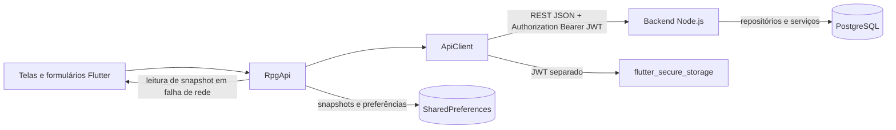

# RPG HUB - Sistema de Gerenciamento de Fichas de RPG

Projeto desenvolvido para a disciplina de **Engenharia de Software** do curso de **Bacharelado em Ciências da Computação** da **UNEMAT (Universidade do Estado de Mato Grosso)**.

- **Docente:** Profª. Maricy Caregnato
- **Discentes:** Danny Anny Terezinha Scholze e Pedro Luiz Mateus de Oliveira

---

## 🎯 Sobre o Projeto

O **RPG HUB** é uma aplicação web moderna focada na experiência do usuário (UX) e na redução de carga cognitiva para jogadores e mestres de RPG de Mesa (adotando a metodologia ágil **b_thinking**). O sistema integra regras, cálculos automáticos em tempo real, fichas dinâmicas, controle de inventário e combate tático.

---

## 🚀 Tecnologias Utilizadas

- **HTML5 & CSS3 Vanilla:** Design moderno Dark Glassmorphism, responsividade e animações fluídas sem frameworks pesados.
- **TypeScript:** Tipagem estática rigorosa e implementação orientada a objetos (POO) aderente ao diagrama de classes UML.
- **Vite:** Ferramenta de build ultrarrápida e servidor de desenvolvimento.
- **Mermaid.js:** Renderização dinâmica dos diagramas UML (Classes, Atividades, Sequência e Casos de Uso) diretamente no navegador.
- **Web Crypto API:** Geração de aleatoriedade criptográfica (`crypto.getRandomValues`) para rolagens de dados justas e precisas.

---

## 📋 Casos de Uso Implementados

* **UC01 - Manter Personagem:** Consulta, edição contínua de PV, Mana, CA, XP e subida de nível em tempo real.
* **UC02 - Criar Personagem Guiado (Wizard):** Assistente passo a passo que valida a distribuição de atributos (faixa de 8 a 18) e calcula automaticamente Modificadores, Pontos de Vida (PV) e Classe de Armadura (CA).
* **UC03 - Gerenciar Inventário:** Cálculo automático de peso total vs. limite de carga máxima da Força (`Força * 7 kg`), com alerta visual instantâneo de **"Sobrecarregado"**.
* **UC04 - Gerenciar Magias e Habilidades:** Cadastro e consulta de feitiços arcanos, custos de recursos e efeitos.
* **UC05 - Realizar Rolagem de Dados:** Rolagens de `1d20 + Modificador` com detecção de Acertos Críticos (20) e Falhas Críticas (1), além de histórico de sessão.
* **UC06 - Manter Campanhas:** Organização do grupo de jogadores, lore e repositório narrativo da mesa pelo Mestre.
* **UC07 - Manter NPCs e Criaturas:** Fichas simplificadas de monstros e ameaças com controle de PV em tempo real.
* **UC08 - Gerenciar Iniciativa:** Painel tático que insere combatentes, rola iniciativa e ordena automaticamente a ordem de turnos do combate.
* **UC09 - Gerenciar Notas e Missões:** Registros pessoais sincronizados entre Web e Mobile, com pastas e campanhas opcionais e exportação `.txt`.
* **Hub UML Interativo:** Visualização em alta definição de todos os diagramas da modelagem do sistema.

---

## 🛠️ Como Executar o Projeto Localmente

### Pré-requisitos
* [Node.js](https://nodejs.org/) (versão 18 ou superior)
* [Git](https://git-scm.com/)

### Passos:
```bash
# 1. Clonar o repositório
git clone https://github.com/pedroluiz1plmo/Projeto_DevSisWeb.git

# 2. Acessar as duas pastas do projeto
|-cd Projeto_DevSisWeb/
|  |-web/
|  |-backend/

# 3. Instalar as dependências nas duas pastas
npm install

# 4. Iniciar o servidor de desenvolvimento
npm run dev

# 5. Acessar no navegador:
# http://localhost:5173/
```

### Para gerar o bundle de produção:
### Fronend
```bash
npm run build
npm run preview
```

## Parte Mobile

## Organização arquitetural

O projeto mantém três fronteiras independentes:

- `web/`: aplicação TypeScript/Vite. Funcionalidades compartilhadas ficam em `src/views`, `src/components`, `src/models`, `src/services` e `src/core`.
- `web/src/systems/`: código web que será específico de cada sistema de RPG. Os diretórios de cada sistema separam `models`, `services`, `views` e `data`.
- `systems/`: conteúdo de RPG independente da aplicação, organizado por sistema em `ficha`, `atributos` e `regras`.

Os diretórios dos sistemas foram criados como limites arquiteturais e permanecem vazios onde ainda não existe implementação real. A ficha genérica, o inventário, a navegação e o controlador principal continuam no frontend compartilhado para preservar o comportamento atual.

### Notas e missões sincronizadas

Notas e missões pertencem ao usuário autenticado e ao workspace ativo (`player`
ou `master`). Pastas e campanhas são associações opcionais; vincular a uma
campanha não compartilha o registro com seus participantes. A exclusão de uma
pasta ou campanha apenas remove o vínculo, preservando a nota ou missão.

A API fornece `GET`, `POST`, `PUT` e `DELETE` em `/api/notes` e `/api/missions`.
As chamadas autenticadas enviam `Authorization: Bearer <JWT>` e
`X-Workspace-Type: player|master`. A migration numerada é executada pelo
comando `npm run migrate` no diretório `backend/`, após configurar as variáveis
de conexão PostgreSQL exigidas em `backend/src/config/database.js`.

O Web preserva o cache local e mantém alterações pendentes para sincronizar
quando a conexão retorna. O Mobile lê e grava os mesmos registros pela API e
permite compartilhar a exportação `.txt`.

### Convites e aprovação de campanhas

No workspace Mestre, o proprietário gerencia convites na seção de participantes:
gera, renova ou revoga um código e pode convidar alguém pelo username. Códigos
e QR Codes apenas permitem solicitar participação; o pedido precisa ser
aprovado pelo Mestre. Convites por username precisam ser aceitos pelo jogador.
Nenhum dos fluxos adiciona participantes antes da aprovação ou do aceite.

No workspace Jogador, a área **Campanhas** permite consultar um código, ler um
QR Code, acompanhar solicitações e responder a convites diretos. A leitura da
câmera no Mobile requer permissão; no Web, o leitor QR depende de contexto
seguro do navegador (HTTPS ou localhost). Os códigos completos são exibidos
somente ao serem gerados/renovados e não são gravados no cache local.

As tabelas usadas pelos dois fluxos são criadas pela migration
`backend/src/database/migrations/019_create_campaign_invitations.sql`. Execute
`npm run migrate` em `backend/` depois de configurar a conexão PostgreSQL; a
migration não é aplicada automaticamente pela interface.

### Acesso offline e cofre local (Web)

Após entrar online, o Web prepara um cofre local usando a senha da conta. Os
registros locais são armazenados no IndexedDB criptografados com AES-GCM-256;
uma chave aleatória de dados é protegida por uma chave derivada da senha com
PBKDF2-HMAC-SHA-256 (600.000 iterações). A criptografia autentica também a
identidade do usuário, o workspace, o tipo e o identificador do registro. A
chave de dados em claro permanece apenas em memória durante o uso e é removida
ao bloquear ou sair.

O acesso offline exige desbloquear explicitamente o cofre com a senha. Ele não
cria JWT, não autentica no servidor e não habilita chamadas remotas. Quando a
conexão retorna, um token de sessão existente só volta a ser usado depois de
validado pelo endpoint autenticado; erros de rede não são tratados como prova
de sessão inválida. A validação do JWT continua exclusivamente no backend
(HS256); nenhum segredo de assinatura é incluído no navegador.

Alterações de senha feitas nas configurações do Web preparam a nova proteção
local antes da chamada ao backend e gravam o novo envelope após a confirmação
remota. Se a atualização local falhar após a senha remota ter sido alterada,
este dispositivo ainda pode exigir a senha anterior para desbloquear o cofre.
Alterações de senha realizadas fora do Web não atualizam automaticamente o
cofre local. Não existe recuperação local da senha nem chave de recuperação:
sem a senha que protege o cofre, os dados criptografados locais não podem ser
desbloqueados. Não apague os dados do navegador se houver alterações locais que
ainda não tenham sido sincronizadas.

Dados legados sem propriedade confiável são preservados em quarentena e não
são carregados automaticamente para uma conta. A migração de dados legados
com escopo verificável é retomável e só remove a origem após gravar e validar
a cópia criptografada. A fila completa de sincronização e a resolução de
conflitos continuam fora desta etapa.

### Frontend Flutter

O app está em `../Projeto_DevSisMob/mobile/`. Após instalar o Flutter SDK:

```sh
cd ../Projeto_DevSisMob/mobile
flutter pub get
flutter run
```

Para Android Emulator, informe `--dart-define=API_BASE_URL=http://10.0.2.2:3000/api`.

### Arquitetura e persistência do Mobile

O aplicativo Flutter mantém a separação por responsabilidade:

- `lib/models/`: modelos tipados e conversão de/para JSON por `fromJson` e
  `toJson`.
- `lib/core/api_client.dart`: cliente HTTP, URL configurável por
  `API_BASE_URL`, serialização JSON, timeout, cabeçalhos e erros HTTP.
- `lib/services/rpg_api.dart`: operações REST, transformação das respostas em
  modelos e atualização do cache depois da confirmação do servidor.
- `lib/services/local_storage.dart`: snapshots JSON e metadados em
  SharedPreferences, limitados por usuário e workspace (`player` ou `master`).
- `lib/services/persona_service.dart`: preferência de perfil Jogador/Mestre
  isolada por usuário.
- `lib/screens/` e `lib/widgets/`: telas, formulários, estados de carregamento,
  avisos do cache local e apresentação de erros.



O JWT é armazenado exclusivamente por `flutter_secure_storage`. Quando existe
token, chamadas autenticadas enviam `Authorization: Bearer <JWT>`; as rotas
públicas de login e cadastro também funcionam sem token. O middleware Node.js
valida o esquema `Bearer` e os recursos protegidos usam o usuário do JWT e o
workspace recebido em `X-Workspace-Type`. O cliente limpa a sessão e notifica
a interface quando uma chamada autenticada recebe `401`; `403`, `404`,
indisponibilidade de rede e erros do servidor são tratados sem registrar o
token.

O `RpgApi` implementa leitura e CRUD para campanhas, personagens, pastas,
notas, missões e monstros; monstros são subordinados a campanhas. As rotas e
serviços backend aplicam autorização e escopo de proprietário/workspace, e os
repositórios persistem no PostgreSQL. Os métodos de sistema e versão usados
pelos formulários são consultas. Os payloads JSON não definem o proprietário:
o backend o deriva da sessão autenticada.

Em operação online, o cache é atualizado somente depois de uma resposta
confirmada pela API. Sem conexão, consultas podem usar snapshots remotos
armazenados para o mesmo usuário e workspace; a interface indica que os dados
são locais e podem estar desatualizados. Escritas offline não são consideradas
concluídas e não são reenviadas automaticamente. Embora o armazenamento
identifique registros locais `LOCAL_ONLY`, não há fila integrada ao CRUD nem
protocolo de sincronização/conflitos nesta versão. Senhas e JWTs não são
armazenados em SharedPreferences. O logout desassocia o cache da sessão; a
limpeza dos dados locais da conta ocorre no fluxo de exclusão da conta.

As telas apresentam progresso durante consultas e usam mensagens de erro
compreensíveis para falhas de rede, sessão, autorização, registros ausentes e
falhas locais; as operações de escrita só exibem sucesso após confirmação da
API. O comando `flutter test` valida contratos e comportamentos com clientes
HTTP simulados. A integração ponta a ponta com servidor Node.js e PostgreSQL
requer ambiente configurado e não é comprovada por esses testes.

### Administração, planos e financeiro

O Backend acrescenta as migrations `016_admin_plans_finance.sql` e
`021_create_free_trials.sql`. Depois de configurar o PostgreSQL, aplique as
migrations no diretório `backend/` com `npm run migrate`; as tabelas de
pagamentos, contratos, despesas, permissões, auditoria e testes gratuitos não
são criadas nem alteradas fora desse processo.

O Freemium é criado ativo sem limites quantitativos. Um limite ausente ou
`null` significa ilimitado; limites definidos pelo ADM são aplicados no Backend
para campanhas, personagens, monstros, notas e missões, somando os workspaces
da conta. Benefícios de planos também são verificados no servidor. Nenhum
recurso existente foi definido como exclusivo do Premium por padrão. Benefícios
e limites associados a esses recursos são verificados pelo servidor durante a
criação; registros já existentes continuam preservados e legíveis.

Para provisionar o primeiro ADM, registre e valide a conta normalmente e então
execute no diretório `backend/`:

```sh
npm run admin:bootstrap -- --user-id 123 --reason "Provisionamento operacional inicial"
```

O comando exige usuário existente e habilitado, concede as permissões
administrativas e registra a operação na trilha de auditoria. Não há cadastro
ADM aberto no Web/Mobile. Permissões administrativas são verificadas no banco
a cada requisição; bloquear uma conta revoga também suas sessões autenticadas.

O painel define usuário ativo como conta habilitada com login dentro da janela
configurável (30 dias inicialmente); bloqueadas e inativas são métricas
separadas. Contas podem usar os workspaces Jogador e Mestre, então as
contagens por workspace não são exclusivas e refletem dados/atividade
cadastrados. Relatórios financeiros agrupam por moeda e não fazem conversão
cambial; líquido usa pagamentos confirmados menos reembolsos, tarifas e
despesas pagas.

### Dashboard Administrativo e Métricas de Utilização

O dashboard administrativo usa os dados reais do PostgreSQL para expor
indicadores do ambiente atual sem criar novas tabelas de perfil. As medidas
principais são:

- UC: usuários com workspace Jogador ativo no sistema;
- UP: usuários com workspace Mestre ativo no sistema;
- UE: usuários com assinatura ativa reconhecida no schema de planos;
- UA: usuários com autorização administrativa válida.

Para a média de utilização de recursos, o cálculo considera o total de
recursos persistidos (`campaigns`, `characters`, `monsters`, `notes` e
`missions`) dividido pelo total de contas cadastradas. O Freemium continua
sendo o plano padrão do sistema quando não existe assinatura ativa; ele não é
contado como UE por si só, porque a estrutura real do projeto persiste a
informação de plano por usuário em `subscriptions` e não em uma tabela de
perfil separada.

A API do dashboard retorna tanto os indicadores de jornada quanto os agregados
de conteúdo, permitindo que a interface administrativa carregue valores reais
sem recalcular regras a partir do localStorage ou do IndexedDB.

Não há provedor de pagamentos configurado. O checkout responde como
indisponível e não cria assinatura nem pagamento simulado; também não há
webhook público sem verificação de assinatura. As tabelas de eventos externos
suportam idempotência para futura integração, e a camada `billing` exige um
provedor real para iniciar checkout ou verificar webhooks.

Notificações de confirmação de assinatura reutilizam o serviço Nodemailer/SMTP
existente e são registradas na migration
`022_create_subscription_email_notifications.sql`. O evento só pode ser
enfileirado junto à transação de pagamento depois que o adaptador do provedor
validar e marcar `payment_provider_events` como `processed`; a chave única
`provider + external_event_id + notification_type` evita novas mensagens quando
o webhook é reprocessado. Falhas ficam registradas e podem ser reenviadas pelo
painel de assinaturas. O checkout e o webhook do provedor ainda não estão
implementados, portanto a confirmação automática só ficará ativa quando um
provedor real validar o webhook, atualizar pagamento/assinatura e enfileirar a
notificação na mesma transação. O Backend processa a fila periodicamente; falhas
ficam registradas e podem ser reenviadas pelo painel de assinaturas. Trial grátis
não gera notificação de assinatura paga.

Configure no ambiente do Backend, sem compartilhar os valores:

```text
SMTP_HOST
SMTP_PORT
SMTP_SECURE
SMTP_USER
SMTP_PASSWORD
SMTP_FROM
SMTP_FROM_NAME=Digital Master Shield
APP_BASE_URL
SUPPORT_EMAIL
```

`SMTP_FROM_NAME` usa Digital Master Shield por padrão e `SUPPORT_EMAIL` usa o
endereço de suporte já adotado pelo serviço de e-mail se omitido. `APP_BASE_URL`
deve ser a URL pública da aplicação para incluir o link no e-mail; sem ela, a
mensagem orienta o usuário a abrir Meu Plano pela plataforma. A migração cria
apenas o registro da fila; nenhum segredo é enviado ao Web ou ao Mobile.

O teste gratuito Premium é registrado uma única vez por conta em
`free_trials`. A migration `021_create_free_trials.sql` fixa o período em sete
dias exatos; o acesso é concedido pelo mesmo `getPlanAccess` usado pelas
assinaturas e retorna ao Freemium quando a data de encerramento passa, salvo se
houver uma assinatura ativa. `GET /api/free-trial/me` consulta elegibilidade e
status e `POST /api/free-trial/activate` inicia o teste do plano escolhido; os
dois endpoints exigem JWT e usam a identidade da sessão. O teste não cria
assinatura, pagamento ou renovação automática. A área administrativa lista os
testes em `GET /api/admin/free-trials`, protegido por `subscriptions.read`;
conversão indica somente a existência de uma assinatura paga registrada após
o encerramento, não confirmação de pagamento.

### Recuperação e exclusão de conta

A migration `017_password_recovery_tokens.sql` cria o armazenamento de tokens
de recuperação. Os tokens são aleatórios, guardados como hash, expiram em 30
minutos e só podem ser usados uma vez; cinco tentativas inválidas esgotam o
código. Configure o SMTP no ambiente do backend antes de habilitar a
recuperação:

```text
SMTP_HOST
SMTP_PORT
SMTP_SECURE=true|false
SMTP_USER
SMTP_PASSWORD
SMTP_FROM
```

`POST /api/auth/password-recovery` aceita `{ "email": "..." }` sem sessão e
sempre responde de forma genérica quanto à existência da conta. O código é
enviado por e-mail. `POST /api/auth/password-recovery/confirm` aceita
`{ "email": "...", "token": "...", "newPassword": "..." }`; não exige sessão.
Sem SMTP configurado, a solicitação retorna `503` sem criar nem simular uma
recuperação. Cada conta pode solicitar até três códigos por hora; tentativas
inválidas também são limitadas pelo código ativo.

`DELETE /api/users/me` exige JWT e `{ "currentPassword": "..." }`. O backend
deriva a conta exclusivamente do `sub` do token. A exclusão é transacional;
registros financeiros com restrição referencial impedem a remoção, enquanto
dados relacionados seguem as regras `ON DELETE` já existentes no PostgreSQL.
